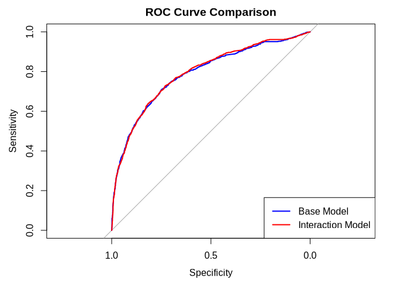
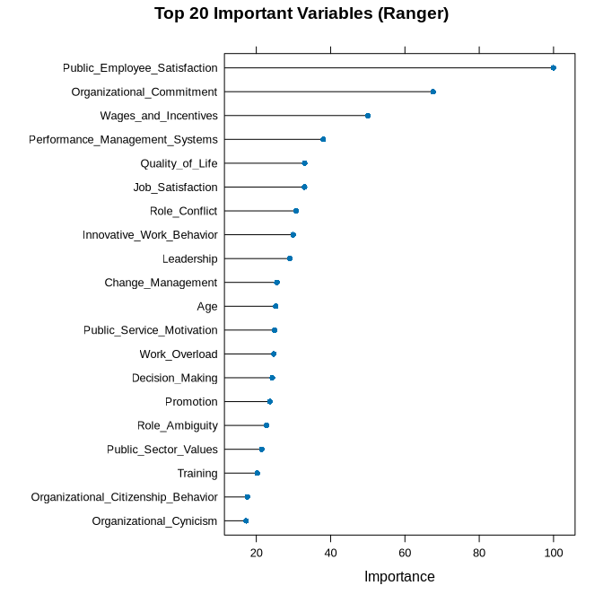
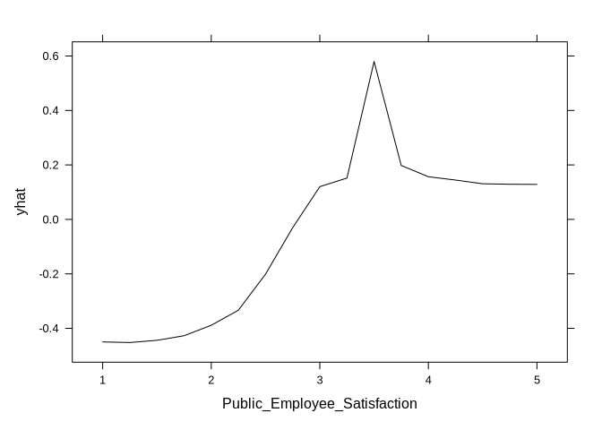

# 머신러닝 분류 모형 실습

분류 모형 비교, 스태킹, 로지스틱 회귀와 랜덤 포레스트 해석을 다룬 분석 코드

- 대학원 과정에서 직접 작성한 분석 코드
- 원자료와 보고서 원문은 비공개
- 실행 결과는 각 폴더의 `.md` 파일 (코드와 출력, 그림을 함께 표시)

| 폴더 | 내용 | 방법 | 도구 |
|---|---|---|---|
| [datamining-stacking](datamining-stacking) | 이진 분류 예측 | 11개 분류기 비교, 스태킹 앙상블 | R |
| [turnover-logistic-ml](turnover-logistic-ml) | MZ세대 공무원 이직의도 | 로지스틱 회귀, 상호작용, 이상치 진단, 머신러닝 비교 | R |

## 방법 설명

- **스태킹 앙상블**: 여러 모형의 예측값을 다시 입력으로 써서 최종 예측을 만드는 방법
- **LASSO**: 예측에 기여가 작은 변수의 계수를 0으로 만들어 변수를 골라 주는 회귀 방법
- **랜덤 포레스트**: 의사결정나무 여러 개의 예측을 모아 최종 예측을 내는 머신러닝 모형
- **부분의존도(PDP)**: 한 변수의 값이 바뀔 때 예측이 평균적으로 어떻게 달라지는지 보여 주는 그림

## 스태킹 분류 모형

`stacking_classification.Rmd`

- 주어진 학습, 시험 자료로 이진 분류 예측
- kNN, 나이브 베이즈, 로지스틱 회귀, GLM, Elastic Net, LDA, QDA, SVM(선형, 방사형, 다항), 랜덤 포레스트, XGBoost를 10겹 5회 반복 교차검증으로 학습해 비교
- 개별 모형의 예측을 입력으로 쓰는 스태킹 모형을 메타 학습기 11종으로 각각 구성해 성능 비교

## MZ세대 공무원 이직의도

`01_logistic_regression.Rmd`, `02_ml_model_comparison.Rmd`, `03_ranger_pdp.Rmd`

- 2023 공직생활실태조사에서 MZ세대(1980년 이후 출생) 응답자를 골라 이직의도(이진)를 예측
- 역문항 처리, 요인 점수 계산, 신뢰도 분석 후 LASSO로 예측변수를 선택해 로지스틱 회귀 적합
- 상호작용 항(평균 중심화)을 넣은 모형과 비교하고, 표준화 잔차와 Cook's distance로 이상치를 찾아 재분석
- caret으로 여러 머신러닝 모형을 비교하고, 랜덤 포레스트(ranger)의 부분의존도(PDP)로 주요 변수 효과 확인
- 실행 결과: [`01_logistic_regression.md`](turnover-logistic-ml/01_logistic_regression.md), [`03_ranger_pdp.md`](turnover-logistic-ml/03_ranger_pdp.md)

**로지스틱 회귀 결과** (MZ세대 응답자 4,288명)

| 모형 | AUC | 정확도 | AIC |
|---|---|---|---|
| 기본 모형 (LASSO 선택 변수) | .788 | .728 | 4802.0 |
| 상호작용 모형 | .792 | .729 | 4776.7 |
| 상호작용 모형, 이상치 9개 제거 | | .731 | 4704.9 |

- 상호작용 항을 넣으면 AIC는 낮아지지만 판별력(AUC)은 거의 같음
- 이상치 제거 후 Hosmer-Lemeshow 검정이 유의하지 않아(p = .479) 모형 적합 개선, 정확도는 Youden 지수 기준 분류점에서 계산

**랜덤 포레스트(ranger) 결과** (학습 3,217명, 평가 1,071명)

- 10겹 5회 반복 교차검증 ROC .828 (mtry = 6, gini, 최소 노드 5), 평가 자료 AUC .799, 정확도 .729
- 변수 중요도 상위: 공직 만족, 조직몰입, 보수와 인센티브, 성과관리제도, 삶의 질

| 변수 중요도 상위 20개 | 공직 만족의 부분의존도 |
|---|---|
|  |  |

- 부분의존도의 세로축은 첫 범주(이직의도 없음)의 로짓이므로 값이 클수록 이직의도 낮음: 공직 만족 3.5점까지는 만족이 높을수록 이직의도가 낮아지고, 그 위 구간에서는 효과가 다소 줄어든 채 평평

- 이 분석의 자료로 이어 간 랜덤 포레스트와 SHAP 해석: [public-sector-turnover-shap](https://github.com/wls0kim/public-sector-turnover-shap)
