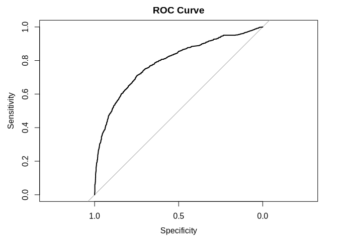
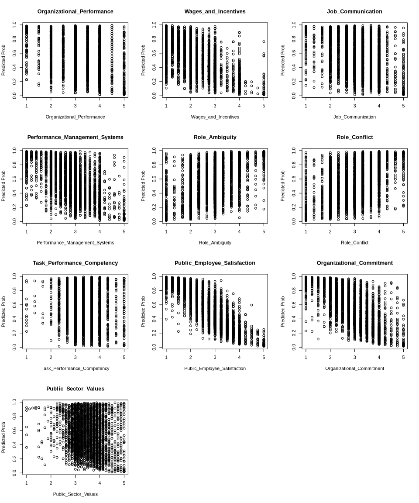
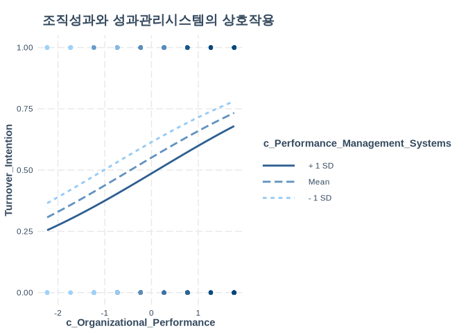
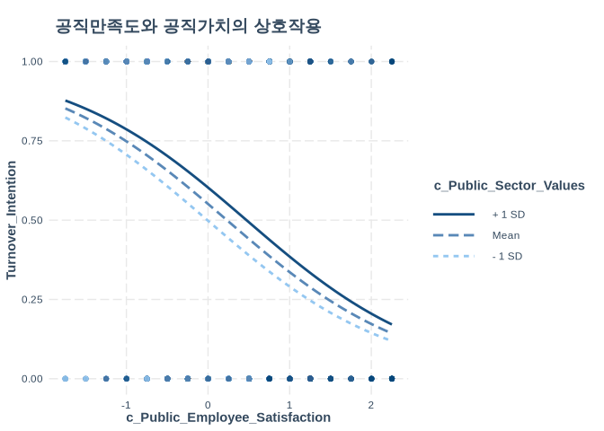
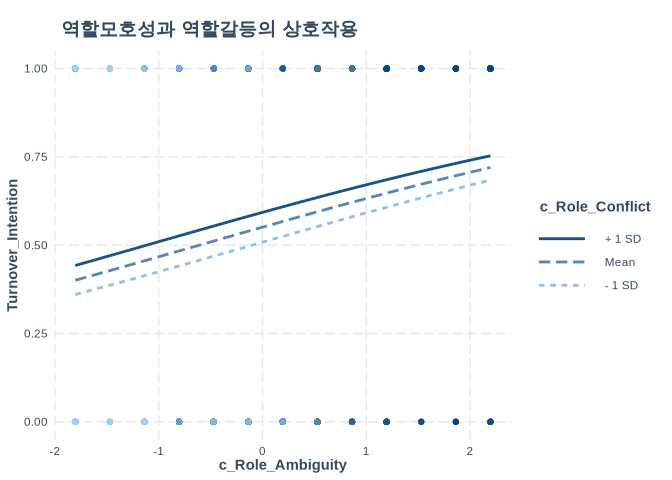
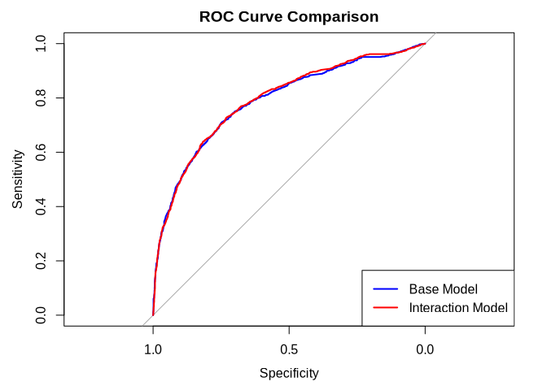
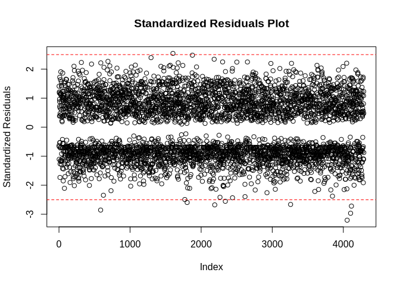
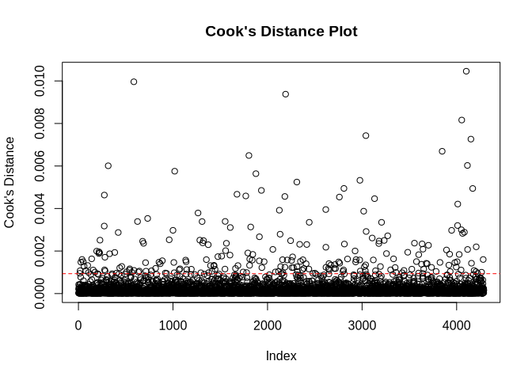
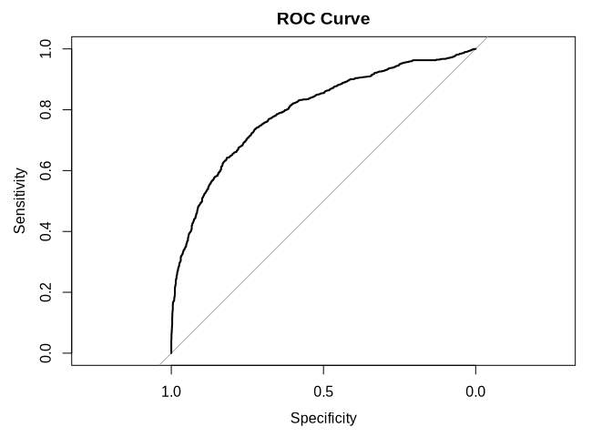
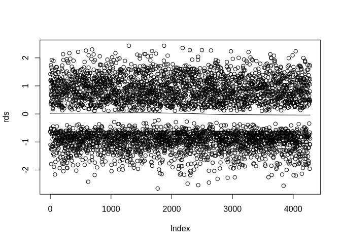

- 2023 공직생활실태조사의 MZ세대 응답자 이직의도(있음/없음)를 로지스틱
  회귀로 예측

- 필요한 파일: `data.xlsx` (2023 공직생활실태조사 원자료)

- 만드는 파일: `data_preprocessed.csv`, `data_cleaned.csv` (다음 단계
  머신러닝 분석의 입력), 신뢰도와 기술통계, 상관 결과 엑셀 파일

- 분석 순서: 전처리와 요인 점수 계산 → 신뢰도 → LASSO로 예측변수 선택 →
  기본 모형 → 상호작용 모형 → 이상치 제거 후 재분석 → 진단

## 1. 준비

``` r
library(readxl)             # 원자료 읽기
```

``` r
library(writexl)            # 결과 엑셀 저장
```

``` r
library(psych)              # 신뢰도, 기술통계
```

``` r
library(Hmisc)              # 상관과 유의확률(rcorr)
```

``` r
library(glmnet)             # LASSO
```

``` r
library(pROC)               # ROC 곡선, AUC
```

``` r
library(pscl)               # McFadden 유사 R²
library(ResourceSelection)  # Hosmer-Lemeshow 적합도 검정
library(car)                # 다중공선성(VIF)
library(moments)            # 왜도, 첨도
library(interactions)       # 상호작용 그래프
library(emmeans)            # 단순 기울기 비교
```

## 2. 전처리

### 2.1. 자료 불러오기와 MZ세대 선별

``` r
data <- read_excel("data.xlsx")
dim(data)
```

    ## [1] 6444  145

``` r
data <- data[data$dq2 >= 1980, ]  # 출생연도(dq2) 1980년 이후를 MZ세대로 정의
summary(data$dq2)
```

    ##    Min. 1st Qu.  Median    Mean 3rd Qu.    Max. 
    ##    1980    1984    1990    1989    1993    2004

``` r
sum(is.na(data))  # 결측치 확인
```

    ## [1] 0

### 2.2. 역문항 처리

- 5점 척도의 부정 방향 문항은 점수 역코딩 (1↔5, 2↔4)

``` r
reverse_vars <- c("q8_5", "q14_4", "q19_5", "q33_5", "q33_6", "q33_7", "q33_8")
data[reverse_vars] <- lapply(data[reverse_vars], function(x) 6 - x)
```

### 2.3. 분석 변수 만들기

- 여러 문항으로 측정한 요인은 문항 평균, 단일 문항 변수는 해당 문항
  그대로 사용
- 연령과 이직의도는 별도 계산

``` r
variable_map <- list(
  Public_Service_Motivation            = paste0("q30_", 1:6),       # 공공봉사동기
  Public_Sector_Values                 = paste0("q34_", 1:8),       # 공직가치
  Public_Employee_Satisfaction         = paste0("q37_", 1:4),       # 공직만족도
  Task_Oriented_Organizational_Culture = c("q21_1", "q21_2"),       # 과업지향 문화
  Relationship_Oriented_Culture        = c("q21_4", "q21_8"),       # 관계지향 문화
  Training                             = paste0("q14_", 1:4),       # 교육훈련, 능력발전
  Average_Weekly_Working_Hours         = "dq11",                    # 주당 평균 근무시간
  Work_Environment                     = "q2",                      # 근무환경
  Organization_Type                    = "orgtype",                 # 기관구분
  Institutional_Classification         = "DM1",                     # 기관유형
  Leadership                           = paste0("q20_", 1:7),       # 리더십
  Job_Rotation                         = paste0("q10_", 1:3),       # 배치전환
  Change_Management                    = paste0("q23_", 1:3),       # 변화관리
  Wages_and_Incentives                 = paste0("q11_", 1:4),       # 보수와 보상
  Organizational_Corruption            = "q29",                     # 부정부패
  Quality_of_Life                      = c("q39_1", "q39_2"),       # 삶의 질
  Performance_Management_Systems       = paste0("q26_", 1:5),       # 성과관리
  Gender                               = "DM2",                     # 성별
  Promotion                            = paste0("q8_", 1:5),        # 승진
  Work_Overload                        = "q31_7",                   # 업무 과중
  Workload                             = "q1",                      # 업무량
  Job_Performance                      = paste0("q27_", 1:3),       # 업무성과
  Task_Performance_Competency          = paste0("q15_", 1:3),       # 업무수행역량
  Job_Autonomy                         = paste0("q4_", 1:3),        # 업무자율성
  Role_Conflict                        = paste0("q31_", 1:3),       # 역할갈등
  Role_Ambiguity                       = paste0("q31_", 4:6),       # 역할모호성
  Age                                  = function(d) 2024 - d$dq2,  # 연령
  Average_Monthly_Salary_Level         = "dq10",                    # 월평균 급여
  Hierarchy_Oriented_Culture           = c("q21_5", "q21_6"),       # 위계지향 문화
  Decision_Making                      = paste0("q22_", 1:4),       # 의사결정
  Turnover_Intention                   = function(d)                # 이직의도: 1~3점 → 0(없음), 4~5점 → 1(있음)
    ifelse(d$q38 %in% c(1, 2, 3), 0, ifelse(d$q38 %in% c(4, 5), 1, NA)),
  Recruitment_Method                   = "dq8",                     # 입직 경로
  Preparation_Period                   = "dq6",                     # 입직 준비 기간
  Number_of_Children_Under_20          = "dq4_2",                   # 자녀 수(만 20세 미만)
  Number_of_Children_Total             = "dq4_1",                   # 자녀 수(전체)
  Organizational_Support               = paste0("q3_", 1:3),        # 자원 제공
  Job_Tenure                           = "dq7",                     # 재직기간
  Professionalism                      = c("q16_1", "q16_2"),       # 전문성 수준
  Organizational_Politics              = c("q21_11", "q21_12"),     # 조직 내 정치
  Organizational_Cynicism              = c("q21_10", "q21_9"),      # 조직 냉소주의
  Organizational_Goals                 = paste0("q19_", 1:5),       # 조직목표
  Organizational_Commitment            = paste0("q35_", 1:4),       # 조직몰입
  Organizational_Performance           = c("q25_1", "q25_2"),       # 조직성과
  Organizational_Citizenship_Behavior  = paste0("q32_", 1:5),       # 조직시민행동
  Job_Rank_Entry                       = "dq9_1",                   # 직급(입직 당시)
  Job_Rank_Current                     = "dq9_2",                   # 직급(현재)
  Job_Satisfaction                     = paste0("q36_", 1:3),       # 직무만족
  Recruitment                          = paste0("q7_", 1:4),        # 채용
  Educational_Level_Entry              = "dq5_1",                   # 학력(입직 당시)
  Educational_Level_Current            = "dq5_2",                   # 학력(현재)
  Innovation_Oriented_Culture          = c("q21_3", "q21_7"),       # 혁신지향 문화
  Innovative_Work_Behavior             = paste0("q33_", 1:8),       # 혁신행동
  Job_Communication                    = paste0("q24_", 1:3),       # 협업, 의사소통
  Salary_Class_System                  = "q12",                     # 호봉제
  Marital_Status                       = "dq3",                     # 혼인상태
  Compensation_and_Welfare             = c("q13_1", "q13_2")        # 후생복지
)

for (v in names(variable_map)) {
  def <- variable_map[[v]]
  data[[v]] <- if (is.function(def))   def(data)                         # 별도 계산
               else if (length(def) == 1) data[[def]]                    # 단일 문항
               else rowMeans(data[, def], na.rm = TRUE)                  # 다문항 요인: 문항 평균
}

# 다문항 요인 목록 (신뢰도 분석에 사용)
factors_list <- Filter(function(def) is.character(def) && length(def) > 1, variable_map)
```

### 2.4. 신뢰도

``` r
alpha_results <- data.frame(
  Factor = names(factors_list),
  Alpha  = sapply(factors_list, function(items) psych::alpha(data[, items])$total$raw_alpha)
)
alpha_results
```

<div class="kable-table">

|  | Factor | Alpha |
|:---|:---|---:|
| Public_Service_Motivation | Public_Service_Motivation | 0.8895793 |
| Public_Sector_Values | Public_Sector_Values | 0.8811872 |
| Public_Employee_Satisfaction | Public_Employee_Satisfaction | 0.8375640 |
| Task_Oriented_Organizational_Culture | Task_Oriented_Organizational_Culture | 0.8111648 |
| Relationship_Oriented_Culture | Relationship_Oriented_Culture | 0.6315575 |
| Training | Training | 0.7261431 |
| Leadership | Leadership | 0.9515362 |
| Job_Rotation | Job_Rotation | 0.7524257 |
| Change_Management | Change_Management | 0.8726081 |
| Wages_and_Incentives | Wages_and_Incentives | 0.9506054 |
| Quality_of_Life | Quality_of_Life | 0.8347600 |
| Performance_Management_Systems | Performance_Management_Systems | 0.9273572 |
| Promotion | Promotion | 0.7647684 |
| Job_Performance | Job_Performance | 0.8802721 |
| Task_Performance_Competency | Task_Performance_Competency | 0.5339437 |
| Job_Autonomy | Job_Autonomy | 0.8239832 |
| Role_Conflict | Role_Conflict | 0.8436539 |
| Role_Ambiguity | Role_Ambiguity | 0.8924845 |
| Hierarchy_Oriented_Culture | Hierarchy_Oriented_Culture | 0.7762806 |
| Decision_Making | Decision_Making | 0.9136704 |
| Organizational_Support | Organizational_Support | 0.8110000 |
| Professionalism | Professionalism | 0.6078386 |
| Organizational_Politics | Organizational_Politics | 0.7635896 |
| Organizational_Cynicism | Organizational_Cynicism | 0.8045178 |
| Organizational_Goals | Organizational_Goals | 0.8099526 |
| Organizational_Commitment | Organizational_Commitment | 0.8647011 |
| Organizational_Performance | Organizational_Performance | 0.8860891 |
| Organizational_Citizenship_Behavior | Organizational_Citizenship_Behavior | 0.8004808 |
| Job_Satisfaction | Job_Satisfaction | 0.8465899 |
| Recruitment | Recruitment | 0.8196900 |
| Innovation_Oriented_Culture | Innovation_Oriented_Culture | 0.6084421 |
| Innovative_Work_Behavior | Innovative_Work_Behavior | 0.8400796 |
| Job_Communication | Job_Communication | 0.8236564 |
| Compensation_and_Welfare | Compensation_and_Welfare | 0.8570104 |

</div>

``` r
write_xlsx(alpha_results, "Cronbach_Alpha_Results.xlsx")
```

### 2.5. 분석용 자료 정리

- 요인 점수 생성 후 원래 문항과 단일 문항의 원변수 삭제

``` r
source_cols <- unique(c(unlist(Filter(is.character, variable_map)),
                        "dq2", "q38"))  # 연령, 이직의도의 원변수
data_cleaned <- data[, !(colnames(data) %in% source_cols)]
str(data_cleaned)
```

    ## tibble [4,288 × 56] (S3: tbl_df/tbl/data.frame)

``` r
write.csv(data,         "data_preprocessed.csv", row.names = FALSE)
write.csv(data_cleaned, "data_cleaned.csv",      row.names = FALSE)
```

## 3. 기술통계와 상관

``` r
numeric_data <- data_cleaned[, sapply(data_cleaned, is.numeric)]

descriptive_stats <- psych::describe(numeric_data)
write_xlsx(data.frame(Variable = rownames(descriptive_stats), descriptive_stats),
           "Descriptive_Statistics.xlsx")

correlation_results <- rcorr(as.matrix(numeric_data))
write_xlsx(list(Correlation_Matrix = as.data.frame(correlation_results$r),
                P_Value_Matrix     = as.data.frame(correlation_results$P)),
           "Correlation_Results.xlsx")
```

## 4. 기본 로지스틱 회귀

### 4.1. LASSO로 예측변수 선택

- 이직의도 예측에 기여하는 변수를 LASSO로 선택
- 교차검증 분할이 무작위라 시드 고정

``` r
x <- model.matrix(Turnover_Intention ~ ., data = data_cleaned)[, -1]
y <- data_cleaned$Turnover_Intention

set.seed(1)
lasso_cv <- cv.glmnet(x, y, alpha = 1, family = "binomial")
lasso_cv$lambda.min  # 교차검증 오차가 가장 작은 람다
```

    ## [1] 0.002822904

``` r
final_lasso <- glmnet(x, y, alpha = 1, lambda = lasso_cv$lambda.min, family = "binomial")
lasso_coefs <- as.matrix(coef(final_lasso))
lasso_coefs <- data.frame(Variable = rownames(lasso_coefs), Coefficient = lasso_coefs[, "s0"])

# 0이 아닌 계수를 절댓값 큰 순서로 정렬
lasso_nonzero <- lasso_coefs[lasso_coefs$Coefficient != 0, ]
lasso_nonzero[order(-abs(lasso_nonzero$Coefficient)), ]
```

<div class="kable-table">

|                                | Variable                       | Coefficient |
|:-------------------------------|:-------------------------------|------------:|
| Public_Employee_Satisfaction   | Public_Employee_Satisfaction   |  -0.7558432 |
| Organizational_Commitment      | Organizational_Commitment      |  -0.5682530 |
| Recruitment_Method             | Recruitment_Method             |   0.5327940 |
| Organizational_Performance     | Organizational_Performance     |   0.3739413 |
| Public_Sector_Values           | Public_Sector_Values           |   0.3162767 |
| Wages_and_Incentives           | Wages_and_Incentives           |  -0.2873195 |
| Job_Communication              | Job_Communication              |   0.2727161 |
| Performance_Management_Systems | Performance_Management_Systems |  -0.2426988 |
| (Intercept)                    | (Intercept)                    |  -0.2354827 |
| Role_Ambiguity                 | Role_Ambiguity                 |   0.2308970 |
| Hierarchy_Oriented_Culture     | Hierarchy_Oriented_Culture     |   0.2031247 |
| Quality_of_Life                | Quality_of_Life                |  -0.1838276 |
| Change_Management              | Change_Management              |  -0.1831757 |
| Promotion                      | Promotion                      |  -0.1750714 |
| Organizational_Goals           | Organizational_Goals           |   0.1526385 |
| Role_Conflict                  | Role_Conflict                  |   0.1496279 |
| Salary_Class_System            | Salary_Class_System            |   0.1376371 |
| Task_Performance_Competency    | Task_Performance_Competency    |   0.1272847 |
| Organizational_Cynicism        | Organizational_Cynicism        |   0.1220342 |
| Gender                         | Gender                         |   0.1193938 |
| Job_Satisfaction               | Job_Satisfaction               |  -0.1174543 |
| Organizational_Support         | Organizational_Support         |   0.1074867 |
| Preparation_Period             | Preparation_Period             |  -0.0898474 |
| Work_Overload                  | Work_Overload                  |   0.0850959 |
| Marital_Status                 | Marital_Status                 |  -0.0753143 |
| Relationship_Oriented_Culture  | Relationship_Oriented_Culture  |   0.0691330 |
| Public_Service_Motivation      | Public_Service_Motivation      |   0.0613187 |
| Work_Environment               | Work_Environment               |  -0.0568231 |
| Average_Weekly_Working_Hours   | Average_Weekly_Working_Hours   |   0.0416842 |
| Professionalism                | Professionalism                |   0.0403128 |
| Educational_Level_Current      | Educational_Level_Current      |   0.0371915 |
| Job_Rank_Entry                 | Job_Rank_Entry                 |   0.0307385 |
| Age                            | Age                            |  -0.0304778 |
| Compensation_and_Welfare       | Compensation_and_Welfare       |   0.0276472 |
| Average_Monthly_Salary_Level   | Average_Monthly_Salary_Level   |   0.0274827 |
| Organization_Type              | Organization_Type              |  -0.0261236 |
| Educational_Level_Entry        | Educational_Level_Entry        |  -0.0250579 |
| Innovative_Work_Behavior       | Innovative_Work_Behavior       |  -0.0171403 |
| Job_Autonomy                   | Job_Autonomy                   |   0.0134848 |

</div>

- LASSO 결과와 이론적 근거를 함께 고려해 조직, 직무, 개인 차원의
  예측변수 10개 선정

``` r
predictors <- c(
  # 조직 차원
  "Organizational_Performance", "Wages_and_Incentives",
  "Job_Communication", "Performance_Management_Systems",
  # 직무 차원
  "Role_Ambiguity", "Role_Conflict", "Task_Performance_Competency",
  # 개인 차원
  "Public_Employee_Satisfaction", "Organizational_Commitment", "Public_Sector_Values"
)

selected_cor <- rcorr(as.matrix(numeric_data[, predictors]))
write_xlsx(list(Correlation_Matrix = as.data.frame(selected_cor$r),
                P_Value_Matrix     = as.data.frame(selected_cor$P)),
           "Selected_Columns_Correlation_and_PValue.xlsx")
```

### 4.2. 모형 평가 함수

- 세 모형(기본, 상호작용, 이상치 제거)을 같은 기준으로 평가하기 위한
  함수

``` r
# 회귀계수와 오즈비
coef_table <- function(model) {
  b <- coef(model)
  data.frame(Variable = names(b), Coefficient = b, Odds_Ratio = exp(b))
}

# ROC 곡선, Youden 지수 기준 최적 분류점, 혼동행렬과 분류 지표
classification_report <- function(model, outcome) {
  probs <- predict(model, type = "response")
  roc_curve <- roc(outcome, probs)
  par(mar = c(4, 4, 2, 2))
  plot(roc_curve, main = "ROC Curve")

  cutoff <- as.numeric(coords(roc_curve, "best", ret = "threshold")[1])
  cat("Optimal cut-off: ", cutoff, "\n")
  cm <- table(Classified = ifelse(probs > cutoff, 1, 0), Actual = outcome)
  print(cm)

  TP <- cm[2, 2]; TN <- cm[1, 1]; FP <- cm[2, 1]; FN <- cm[1, 2]
  cat("Accuracy:    ", round((TP + TN) / sum(cm), 4), "\n")
  cat("Sensitivity: ", round(TP / (TP + FN), 4), "\n")  # 민감도
  cat("Specificity: ", round(TN / (TN + FP), 4), "\n")  # 특이도
  cat("FPR:         ", round(FP / (FP + TN), 4), "\n")  # 위양성률
  cat("FNR:         ", round(FN / (FN + TP), 4), "\n")  # 위음성률
}

# 정보 기준, 유사 R², Hosmer-Lemeshow 검정
fit_report <- function(model, outcome) {
  cat("AIC: ", AIC(model), "\n")
  cat("BIC: ", BIC(model), "\n")
  cat("Pseudo R2: ", pR2(model), "\n")
  cat("Hosmer-Lemeshow p: ", hoslem.test(outcome, fitted(model))$p.value, "\n")
}
```

### 4.3. 모형 적합

``` r
model <- glm(reformulate(predictors, "Turnover_Intention"),
             data = data_cleaned, family = binomial())
summary(model)
```

    ## 
    ## Call:
    ## glm(formula = reformulate(predictors, "Turnover_Intention"), 
    ##     family = binomial(), data = data_cleaned)
    ## 
    ## Coefficients:
    ##                                Estimate Std. Error z value Pr(>|z|)    
    ## (Intercept)                     0.59996    0.36927   1.625  0.10423    
    ## Organizational_Performance      0.41708    0.07553   5.522 3.35e-08 ***
    ## Wages_and_Incentives           -0.36515    0.04687  -7.791 6.63e-15 ***
    ## Job_Communication               0.29917    0.07290   4.104 4.06e-05 ***
    ## Performance_Management_Systems -0.31016    0.07659  -4.050 5.13e-05 ***
    ## Role_Ambiguity                  0.34231    0.05698   6.008 1.88e-09 ***
    ## Role_Conflict                   0.17734    0.05958   2.977  0.00291 ** 
    ## Task_Performance_Competency     0.11533    0.07335   1.572  0.11588    
    ## Public_Employee_Satisfaction   -0.87070    0.06043 -14.407  < 2e-16 ***
    ## Organizational_Commitment      -0.66560    0.07092  -9.386  < 2e-16 ***
    ## Public_Sector_Values            0.41264    0.08636   4.778 1.77e-06 ***
    ## ---
    ## Signif. codes:  0 '***' 0.001 '**' 0.01 '*' 0.05 '.' 0.1 ' ' 1
    ## 
    ## (Dispersion parameter for binomial family taken to be 1)
    ## 
    ##     Null deviance: 5933.3  on 4287  degrees of freedom
    ## Residual deviance: 4780.0  on 4277  degrees of freedom
    ## AIC: 4802
    ## 
    ## Number of Fisher Scoring iterations: 4

``` r
coef_table(model)
```

<div class="kable-table">

|  | Variable | Coefficient | Odds_Ratio |
|:---|:---|---:|---:|
| (Intercept) | (Intercept) | 0.5999591 | 1.8220443 |
| Organizational_Performance | Organizational_Performance | 0.4170787 | 1.5175219 |
| Wages_and_Incentives | Wages_and_Incentives | -0.3651494 | 0.6940930 |
| Job_Communication | Job_Communication | 0.2991651 | 1.3487323 |
| Performance_Management_Systems | Performance_Management_Systems | -0.3101590 | 0.7333303 |
| Role_Ambiguity | Role_Ambiguity | 0.3423143 | 1.4082029 |
| Role_Conflict | Role_Conflict | 0.1773394 | 1.1940363 |
| Task_Performance_Competency | Task_Performance_Competency | 0.1153258 | 1.1222390 |
| Public_Employee_Satisfaction | Public_Employee_Satisfaction | -0.8706955 | 0.4186603 |
| Organizational_Commitment | Organizational_Commitment | -0.6656037 | 0.5139632 |
| Public_Sector_Values | Public_Sector_Values | 0.4126400 | 1.5108011 |

</div>

``` r
classification_report(model, data_cleaned$Turnover_Intention)
```

    ## Setting levels: control = 0, case = 1

    ## Setting direction: controls < cases

<!-- -->

    ## Optimal cut-off:  0.5090362 
    ##           Actual
    ## Classified    0    1
    ##          0 1523  654
    ##          1  512 1599
    ## Accuracy:     0.7281 
    ## Sensitivity:  0.7097 
    ## Specificity:  0.7484 
    ## FPR:          0.2516 
    ## FNR:          0.2903

``` r
fit_report(model, data$Turnover_Intention)
```

    ## AIC:  4801.999 
    ## BIC:  4871.999 
    ## fitting null model for pseudo-r2
    ## Pseudo R2:  -2390 -2966.671 1153.343 0.1943834 0.2358338 0.3147167 
    ## Hosmer-Lemeshow p:  1.444144e-09

### 4.4. 예측변수와 예측확률의 관계

- 적합도가 낮은 원인을 찾기 위해 예측변수별 예측확률 시각화

``` r
probs <- predict(model, type = "response")
par(mfrow = c(4, 3))
for (v in predictors) {
  plot(data_cleaned[[v]], probs, main = v, xlab = v, ylab = "Predicted Prob")
}
par(mfrow = c(1, 1))
```

<!-- -->

## 5. 상호작용 모형

### 5.1. 평균 중심화와 상호작용 항

- 다중공선성을 줄이기 위해 예측변수를 평균 중심화한 뒤 상호작용 항 생성

``` r
for (v in predictors) {
  data_cleaned[[paste0("c_", v)]] <- as.numeric(scale(data_cleaned[[v]], center = TRUE, scale = FALSE))
}

data_cleaned$Interaction_OP_PMS  <- data_cleaned$c_Organizational_Performance   * data_cleaned$c_Performance_Management_Systems  # 조직성과 × 성과관리
data_cleaned$Interaction_RA_RC   <- data_cleaned$c_Role_Ambiguity               * data_cleaned$c_Role_Conflict                   # 역할모호성 × 역할갈등
data_cleaned$Interaction_PES_PSV <- data_cleaned$c_Public_Employee_Satisfaction * data_cleaned$c_Public_Sector_Values            # 공직만족 × 공직가치

interaction_formula <- reformulate(
  c(paste0("c_", predictors), "Interaction_OP_PMS", "Interaction_RA_RC", "Interaction_PES_PSV"),
  "Turnover_Intention"
)
```

### 5.2. 모형 적합

``` r
model_interaction <- glm(interaction_formula, data = data_cleaned, family = binomial())
summary(model_interaction)
```

    ## 
    ## Call:
    ## glm(formula = interaction_formula, family = binomial(), data = data_cleaned)
    ## 
    ## Coefficients:
    ##                                  Estimate Std. Error z value Pr(>|z|)    
    ## (Intercept)                       0.08563    0.04016   2.132 0.032976 *  
    ## c_Organizational_Performance      0.45633    0.07710   5.919 3.24e-09 ***
    ## c_Wages_and_Incentives           -0.36766    0.04665  -7.882 3.23e-15 ***
    ## c_Job_Communication               0.29715    0.07329   4.054 5.03e-05 ***
    ## c_Performance_Management_Systems -0.34337    0.07697  -4.461 8.15e-06 ***
    ## c_Role_Ambiguity                  0.33645    0.05751   5.850 4.92e-09 ***
    ## c_Role_Conflict                   0.21438    0.06069   3.532 0.000412 ***
    ## c_Task_Performance_Competency     0.07855    0.07426   1.058 0.290166    
    ## c_Public_Employee_Satisfaction   -0.88566    0.06173 -14.348  < 2e-16 ***
    ## c_Organizational_Commitment      -0.64969    0.07109  -9.139  < 2e-16 ***
    ## c_Public_Sector_Values            0.38705    0.08773   4.412 1.02e-05 ***
    ## Interaction_OP_PMS                0.18209    0.05602   3.250 0.001153 ** 
    ## Interaction_RA_RC                 0.06169    0.05134   1.202 0.229469    
    ## Interaction_PES_PSV               0.20795    0.08583   2.423 0.015400 *  
    ## ---
    ## Signif. codes:  0 '***' 0.001 '**' 0.01 '*' 0.05 '.' 0.1 ' ' 1
    ## 
    ## (Dispersion parameter for binomial family taken to be 1)
    ## 
    ##     Null deviance: 5933.3  on 4287  degrees of freedom
    ## Residual deviance: 4748.7  on 4274  degrees of freedom
    ## AIC: 4776.7
    ## 
    ## Number of Fisher Scoring iterations: 4

``` r
coef_table(model_interaction)
```

<div class="kable-table">

|  | Variable | Coefficient | Odds_Ratio |
|:---|:---|---:|---:|
| (Intercept) | (Intercept) | 0.0856290 | 1.0894020 |
| c_Organizational_Performance | c_Organizational_Performance | 0.4563276 | 1.5782673 |
| c_Wages_and_Incentives | c_Wages_and_Incentives | -0.3676564 | 0.6923550 |
| c_Job_Communication | c_Job_Communication | 0.2971482 | 1.3460147 |
| c_Performance_Management_Systems | c_Performance_Management_Systems | -0.3433684 | 0.7093768 |
| c_Role_Ambiguity | c_Role_Ambiguity | 0.3364537 | 1.3999741 |
| c_Role_Conflict | c_Role_Conflict | 0.2143837 | 1.2390980 |
| c_Task_Performance_Competency | c_Task_Performance_Competency | 0.0785455 | 1.0817126 |
| c_Public_Employee_Satisfaction | c_Public_Employee_Satisfaction | -0.8856601 | 0.4124418 |
| c_Organizational_Commitment | c_Organizational_Commitment | -0.6496913 | 0.5222070 |
| c_Public_Sector_Values | c_Public_Sector_Values | 0.3870513 | 1.4726321 |
| Interaction_OP_PMS | Interaction_OP_PMS | 0.1820903 | 1.1997225 |
| Interaction_RA_RC | Interaction_RA_RC | 0.0616909 | 1.0636335 |
| Interaction_PES_PSV | Interaction_PES_PSV | 0.2079488 | 1.2311501 |

</div>

``` r
classification_report(model_interaction, data_cleaned$Turnover_Intention)
```

    ## Setting levels: control = 0, case = 1

    ## Setting direction: controls < cases

<!-- -->

    ## Optimal cut-off:  0.4925904 
    ##           Actual
    ## Classified    0    1
    ##          0 1490  617
    ##          1  545 1636
    ## Accuracy:     0.729 
    ## Sensitivity:  0.7261 
    ## Specificity:  0.7322 
    ## FPR:          0.2678 
    ## FNR:          0.2739

``` r
fit_report(model_interaction, data$Turnover_Intention)
```

    ## AIC:  4776.721 
    ## BIC:  4865.811 
    ## fitting null model for pseudo-r2
    ## Pseudo R2:  -2374.36 -2966.671 1184.622 0.1996551 0.2413877 0.3221283 
    ## Hosmer-Lemeshow p:  0.2868159

### 5.3. 상호작용 해석

``` r
interact_plot(model_interaction, pred = c_Organizational_Performance,
              modx = c_Performance_Management_Systems, plot.points = TRUE,
              main.title = "조직성과와 성과관리시스템의 상호작용")
```

    ## Warning: c_Organizational_Performance and c_Performance_Management_Systems are not
    ## included in an interaction with one another in the model.

<!-- -->

``` r
interact_plot(model_interaction, pred = c_Public_Employee_Satisfaction,
              modx = c_Public_Sector_Values, plot.points = TRUE,
              main.title = "공직만족도와 공직가치의 상호작용")
```

    ## Warning: c_Public_Employee_Satisfaction and c_Public_Sector_Values are not included
    ## in an interaction with one another in the model.

<!-- -->

``` r
interact_plot(model_interaction, pred = c_Role_Ambiguity,
              modx = c_Role_Conflict, plot.points = TRUE,
              main.title = "역할모호성과 역할갈등의 상호작용")
```

    ## Warning: c_Role_Ambiguity and c_Role_Conflict are not included in an interaction
    ## with one another in the model.

<!-- -->

``` r
# 조절변수 수준별 단순 기울기 비교
emtrends(model_interaction, pairwise ~ c_Performance_Management_Systems, var = "c_Organizational_Performance")
```

    ## $emtrends
    ##  c_Performance_Management_Systems c_Organizational_Performance.trend     SE  df
    ##                          1.06e-16                              0.456 0.0771 Inf
    ##  asymp.LCL asymp.UCL
    ##      0.305     0.607
    ## 
    ## Confidence level used: 0.95 
    ## 
    ## $contrasts
    ##  contrast  estimate SE df z.ratio p.value
    ##  (nothing)   nonEst NA NA      NA      NA

``` r
emtrends(model_interaction, pairwise ~ c_Public_Employee_Satisfaction,   var = "c_Public_Sector_Values")
```

    ## $emtrends
    ##  c_Public_Employee_Satisfaction c_Public_Sector_Values.trend     SE  df
    ##                        1.52e-16                        0.387 0.0877 Inf
    ##  asymp.LCL asymp.UCL
    ##      0.215     0.559
    ## 
    ## Confidence level used: 0.95 
    ## 
    ## $contrasts
    ##  contrast  estimate SE df z.ratio p.value
    ##  (nothing)   nonEst NA NA      NA      NA

## 6. 기본 모형과 상호작용 모형 비교

``` r
anova(model, model_interaction, test = "Chisq")  # 이탈도 차이 검정
```

<div class="kable-table">

| Resid. Df | Resid. Dev |  Df | Deviance | Pr(\>Chi) |
|----------:|-----------:|----:|---------:|----------:|
|      4277 |   4779.999 |  NA |       NA |        NA |
|      4274 |   4748.721 |   3 | 31.27864 |     7e-07 |

</div>

``` r
roc_base        <- roc(data_cleaned$Turnover_Intention, predict(model, type = "response"))
```

    ## Setting levels: control = 0, case = 1

    ## Setting direction: controls < cases

``` r
roc_interaction <- roc(data_cleaned$Turnover_Intention, predict(model_interaction, type = "response"))
```

    ## Setting levels: control = 0, case = 1
    ## Setting direction: controls < cases

``` r
cat("Base Model AUC: ",        auc(roc_base), "\n")
```

    ## Base Model AUC:  0.7880739

``` r
cat("Interaction Model AUC: ", auc(roc_interaction), "\n")
```

    ## Interaction Model AUC:  0.7915372

``` r
plot(roc_base, col = "blue", main = "ROC Curve Comparison")
plot(roc_interaction, col = "red", add = TRUE)
legend("bottomright", legend = c("Base Model", "Interaction Model"),
       col = c("blue", "red"), lwd = 2)
```

<!-- -->

## 7. 이상치 탐지

- 표준화 잔차(\|z\| \> 2.5)와 Cook’s distance(4 / (n - k - 1) 초과)를
  모두 넘는 사례를 이상치로 판단

``` r
std_resid <- rstandard(model_interaction)
outliers_resid <- which(abs(std_resid) > 2.5)
outliers_resid
```

    ##  586 1603 1803 2191 2340 3258 4054 4102 4114 
    ##  586 1603 1803 2191 2340 3258 4054 4102 4114

``` r
plot(std_resid, ylab = "Standardized Residuals", main = "Standardized Residuals Plot")
abline(h = c(-2.5, 2.5), col = "red", lty = 2)
```

<!-- -->

``` r
n <- nrow(data_cleaned)
k <- length(coef(model_interaction)) - 1
cooksd <- cooks.distance(model_interaction)
cook_threshold <- 4 / (n - k - 1)
outliers_cook <- which(cooksd > cook_threshold)
outliers_cook
```

    ##   14   18   26   38   50   60   77   98  107  140  156  175  193  216  217  224 
    ##   14   18   26   38   50   60   77   98  107  140  156  175  193  216  217  224 
    ##  228  273  274  277  280  282  315  330  384  401  421  437  458  511  540  542 
    ##  228  273  274  277  280  282  315  330  384  401  421  437  458  511  540  542 
    ##  565  586  588  625  633  644  679  689  710  715  732  773  816  852  865  887 
    ##  565  586  588  625  633  644  679  689  710  715  732  773  816  852  865  887 
    ##  919  933  960 1000 1009 1013 1018 1066 1074 1134 1139 1146 1194 1265 1284 1295 
    ##  919  933  960 1000 1009 1013 1018 1066 1074 1134 1139 1146 1194 1265 1284 1295 
    ## 1308 1314 1323 1353 1373 1378 1397 1413 1433 1434 1445 1475 1515 1550 1552 1557 
    ## 1308 1314 1323 1353 1373 1378 1397 1413 1433 1434 1445 1475 1515 1550 1552 1557 
    ## 1565 1603 1606 1661 1677 1687 1742 1770 1779 1792 1803 1810 1812 1822 1838 1844 
    ## 1565 1603 1606 1661 1677 1687 1742 1770 1779 1792 1803 1810 1812 1822 1838 1844 
    ## 1877 1913 1914 1935 1940 1964 2056 2083 2116 2125 2133 2139 2159 2163 2183 2184 
    ## 1877 1913 1914 1935 1940 1964 2056 2083 2116 2125 2133 2139 2159 2163 2183 2184 
    ## 2191 2208 2244 2254 2258 2265 2274 2310 2312 2317 2340 2348 2368 2374 2384 2408 
    ## 2191 2208 2244 2254 2258 2265 2274 2310 2312 2317 2340 2348 2368 2374 2384 2408 
    ## 2415 2437 2441 2480 2502 2616 2617 2618 2644 2650 2651 2671 2705 2713 2719 2753 
    ## 2415 2437 2441 2480 2502 2616 2617 2618 2644 2650 2651 2671 2705 2713 2719 2753 
    ## 2760 2763 2798 2804 2808 2813 2846 2926 2932 2937 2975 2977 2981 3017 3024 3034 
    ## 2760 2763 2798 2804 2808 2813 2846 2926 2932 2937 2975 2977 2981 3017 3024 3034 
    ## 3038 3040 3043 3107 3119 3132 3142 3177 3180 3194 3206 3234 3258 3271 3302 3333 
    ## 3038 3040 3043 3107 3119 3132 3142 3177 3180 3194 3206 3234 3258 3271 3302 3333 
    ## 3350 3359 3424 3443 3483 3526 3554 3575 3598 3599 3629 3635 3641 3644 3652 3679 
    ## 3350 3359 3424 3443 3483 3526 3554 3575 3598 3599 3629 3635 3641 3644 3652 3679 
    ## 3688 3702 3734 3783 3824 3847 3893 3918 3926 3932 3947 3981 3996 4005 4010 4012 
    ## 3688 3702 3734 3783 3824 3847 3893 3918 3926 3932 3947 3981 3996 4005 4010 4012 
    ## 4027 4047 4050 4054 4063 4082 4102 4114 4116 4151 4157 4170 4185 4205 4207 4222 
    ## 4027 4047 4050 4054 4063 4082 4102 4114 4116 4151 4157 4170 4185 4205 4207 4222 
    ## 4264 4281 
    ## 4264 4281

``` r
plot(cooksd, ylab = "Cook's Distance", main = "Cook's Distance Plot")
abline(h = cook_threshold, col = "red", lty = 2)
```

<!-- -->

``` r
common_outliers <- intersect(outliers_resid, outliers_cook)  # 두 기준 모두에 해당하는 사례
common_outliers
```

    ## [1]  586 1603 1803 2191 2340 3258 4054 4102 4114

## 8. 이상치 제거 후 재분석

``` r
data_no_outliers <- data_cleaned[-common_outliers, ]

final_model <- glm(interaction_formula, data = data_no_outliers, family = binomial())
summary(final_model)
```

    ## 
    ## Call:
    ## glm(formula = interaction_formula, family = binomial(), data = data_no_outliers)
    ## 
    ## Coefficients:
    ##                                  Estimate Std. Error z value Pr(>|z|)    
    ## (Intercept)                       0.07781    0.04047   1.923 0.054509 .  
    ## c_Organizational_Performance      0.44641    0.07782   5.736 9.69e-09 ***
    ## c_Wages_and_Incentives           -0.37167    0.04701  -7.907 2.64e-15 ***
    ## c_Job_Communication               0.31770    0.07418   4.283 1.84e-05 ***
    ## c_Performance_Management_Systems -0.37243    0.07790  -4.781 1.74e-06 ***
    ## c_Role_Ambiguity                  0.36210    0.05822   6.220 4.99e-10 ***
    ## c_Role_Conflict                   0.22798    0.06142   3.712 0.000206 ***
    ## c_Task_Performance_Competency     0.07206    0.07514   0.959 0.337532    
    ## c_Public_Employee_Satisfaction   -0.91154    0.06265 -14.551  < 2e-16 ***
    ## c_Organizational_Commitment      -0.67964    0.07212  -9.423  < 2e-16 ***
    ## c_Public_Sector_Values            0.40931    0.08894   4.602 4.18e-06 ***
    ## Interaction_OP_PMS                0.23783    0.05795   4.104 4.06e-05 ***
    ## Interaction_RA_RC                 0.08706    0.05253   1.658 0.097405 .  
    ## Interaction_PES_PSV               0.22357    0.08797   2.541 0.011040 *  
    ## ---
    ## Signif. codes:  0 '***' 0.001 '**' 0.01 '*' 0.05 '.' 0.1 ' ' 1
    ## 
    ## (Dispersion parameter for binomial family taken to be 1)
    ## 
    ##     Null deviance: 5920.1  on 4278  degrees of freedom
    ## Residual deviance: 4676.9  on 4265  degrees of freedom
    ## AIC: 4704.9
    ## 
    ## Number of Fisher Scoring iterations: 5

``` r
coef_table(final_model)
```

<div class="kable-table">

|  | Variable | Coefficient | Odds_Ratio |
|:---|:---|---:|---:|
| (Intercept) | (Intercept) | 0.0778089 | 1.0809161 |
| c_Organizational_Performance | c_Organizational_Performance | 0.4464059 | 1.5626856 |
| c_Wages_and_Incentives | c_Wages_and_Incentives | -0.3716653 | 0.6895850 |
| c_Job_Communication | c_Job_Communication | 0.3176992 | 1.3739628 |
| c_Performance_Management_Systems | c_Performance_Management_Systems | -0.3724331 | 0.6890558 |
| c_Role_Ambiguity | c_Role_Ambiguity | 0.3621003 | 1.4363431 |
| c_Role_Conflict | c_Role_Conflict | 0.2279793 | 1.2560594 |
| c_Task_Performance_Competency | c_Task_Performance_Competency | 0.0720603 | 1.0747201 |
| c_Public_Employee_Satisfaction | c_Public_Employee_Satisfaction | -0.9115415 | 0.4019042 |
| c_Organizational_Commitment | c_Organizational_Commitment | -0.6796378 | 0.5068005 |
| c_Public_Sector_Values | c_Public_Sector_Values | 0.4093127 | 1.5057825 |
| Interaction_OP_PMS | Interaction_OP_PMS | 0.2378329 | 1.2684972 |
| Interaction_RA_RC | Interaction_RA_RC | 0.0870649 | 1.0909675 |
| Interaction_PES_PSV | Interaction_PES_PSV | 0.2235691 | 1.2505321 |

</div>

``` r
classification_report(final_model, data_no_outliers$Turnover_Intention)
```

    ## Setting levels: control = 0, case = 1

    ## Setting direction: controls < cases

<!-- -->

    ## Optimal cut-off:  0.4863964 
    ##           Actual
    ## Classified    0    1
    ##          0 1473  597
    ##          1  554 1655
    ## Accuracy:     0.731 
    ## Sensitivity:  0.7349 
    ## Specificity:  0.7267 
    ## FPR:          0.2733 
    ## FNR:          0.2651

``` r
fit_report(final_model, data_no_outliers$Turnover_Intention)
```

    ## AIC:  4704.899 
    ## BIC:  4793.96 
    ## fitting null model for pseudo-r2
    ## Pseudo R2:  -2338.45 -2960.059 1243.218 0.2099988 0.2521399 0.3364972 
    ## Hosmer-Lemeshow p:  0.478762

## 9. 최종 모형 진단

``` r
rds <- residuals(final_model)
plot(rds)
lines(lowess(rds))
```

<!-- -->

``` r
cat("Skewness: ", skewness(rds), "\n")  # 잔차 왜도
```

    ## Skewness:  0.01226986

``` r
cat("Kurtosis: ", kurtosis(rds), "\n")  # 잔차 첨도
```

    ## Kurtosis:  1.731389

``` r
vif(final_model)  # 다중공선성
```

    ##     c_Organizational_Performance           c_Wages_and_Incentives 
    ##                         2.166782                         1.190715 
    ##              c_Job_Communication c_Performance_Management_Systems 
    ##                         2.031737                         2.159281 
    ##                 c_Role_Ambiguity                  c_Role_Conflict 
    ##                         1.507336                         1.606101 
    ##    c_Task_Performance_Competency   c_Public_Employee_Satisfaction 
    ##                         1.291851                         1.409734 
    ##      c_Organizational_Commitment           c_Public_Sector_Values 
    ##                         1.776701                         1.695623 
    ##               Interaction_OP_PMS                Interaction_RA_RC 
    ##                         1.291549                         1.235079 
    ##              Interaction_PES_PSV 
    ##                         1.204558
