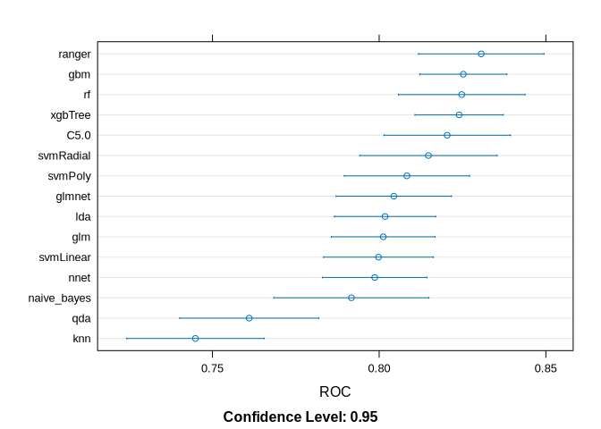

- 로지스틱 회귀와 같은 자료로 머신러닝 분류 모형 15개의 이직의도 예측
  성능 비교

- 필요한 파일: `data_cleaned.csv` (`01_logistic_regression.Rmd`가 만든
  파일)

- 클래스 불균형 완화: 교차검증의 각 학습 폴드 안에서 SMOTE로 표본 증대
  (`themis` 패키지 필요)

## 1. 준비

``` r
library(caret)          # 모형 학습과 교차검증
```

``` r
library(caretEnsemble)  # 여러 모형을 한 번에 학습(caretList)
```

``` r
library(doParallel)     # 병렬 처리

# caret이 아래 모형을 학습할 때 쓰는 패키지
library(glmnet); library(e1071); library(randomForest); library(naivebayes)
```

``` r
library(xgboost); library(gbm); library(C50); library(ranger); library(nnet)
```

``` r
library(MASS); library(class)
```

``` r
registerDoParallel(detectCores())
```

## 2. 자료 준비

``` r
data <- read.csv("data_cleaned.csv")
dim(data)
```

    ## [1] 4288   56

``` r
# 이직의도를 범주형으로 변환 (caret의 ROC 계산에는 "No", "Yes" 같은 문자 수준 필요)
data$Turnover_Intention <- factor(data$Turnover_Intention, levels = c(0, 1), labels = c("No", "Yes"))
table(data$Turnover_Intention)
```

    ## 
    ##   No  Yes 
    ## 2035 2253

- 이직의도 비율을 유지한 채 학습 75%, 평가 25%로 분할

``` r
set.seed(1)
train_idx  <- createDataPartition(data$Turnover_Intention, p = 0.75, list = FALSE)
train_data <- data[train_idx, ]
test_data  <- data[-train_idx, ]

table(train_data$Turnover_Intention)
```

    ## 
    ##   No  Yes 
    ## 1527 1690

``` r
table(test_data$Turnover_Intention)
```

    ## 
    ##  No Yes 
    ## 508 563

## 3. 모형 학습

### 3.1. 교차검증 설정

``` r
set.seed(1)
my_folds <- createFolds(train_data$Turnover_Intention, k = 10, returnTrain = TRUE)

stack_control <- trainControl(
  method          = "cv", number = 10,
  index           = my_folds,  # 모든 모형이 같은 10겹 폴드를 쓰도록 고정 (스태킹 비교용)
  savePredictions = "all",
  classProbs      = TRUE,
  sampling        = "smote",   # 학습 폴드 안에서 소수 클래스(Yes) 합성
  summaryFunction = twoClassSummary,  # ROC, 민감도, 특이도
  allowParallel   = TRUE
)

model_list <- c("knn", "naive_bayes", "glm", "glmnet",
                "lda", "qda", "svmLinear", "svmRadial", "svmPoly",
                "rf", "xgbTree", "gbm", "C5.0", "ranger", "nnet")
```

### 3.2. 15개 모형 학습

``` r
fit <- caretList(
  Turnover_Intention ~ ., data = train_data,
  methodList = model_list,
  trControl  = stack_control,
  metric     = "ROC",
  preProcess = c("center", "scale")
)
```

    ## Warning in nominalTrainWorkflow(x = x, y = y, wts = weights, info = trainInfo,
    ## : There were missing values in resampled performance measures.

    ## Warning in nominalTrainWorkflow(x = x, y = y, wts = weights, info = trainInfo,
    ## : There were missing values in resampled performance measures.

``` r
fit                                         # 모형별 교차검증 결과
```

    ## $knn
    ## k-Nearest Neighbors 
    ## 
    ## Pre-processing: centered (55), scaled (55) 
    ## Addtional sampling using SMOTE prior to pre-processing
    ## 
    ## Resampling results across tuning parameters:
    ## 
    ##   k  ROC        Sens       Spec     
    ##   5  0.7237846  0.8866830  0.4177515
    ##   7  0.7346390  0.9108961  0.3893491
    ##   9  0.7448850  0.9122248  0.3781065
    ## 
    ## ROC was used to select the optimal model using the largest value.
    ## The final value used for the model was k = 9.
    ## 
    ## $naive_bayes
    ## Naive Bayes 
    ## 
    ## Pre-processing: centered (55), scaled (55) 
    ## Addtional sampling using SMOTE prior to pre-processing
    ## 
    ## Resampling results across tuning parameters:
    ## 
    ##   usekernel  ROC        Sens       Spec     
    ##   FALSE      0.7634156  0.7975877  0.5928994
    ##    TRUE      0.7916769  0.8807964  0.4662722
    ## 
    ## Tuning parameter 'laplace' was held constant at a value of 0
    ## Tuning
    ##  parameter 'adjust' was held constant at a value of 1
    ## ROC was used to select the optimal model using the largest value.
    ## The final values used for the model were laplace = 0, usekernel = TRUE
    ##  and adjust = 1.
    ## 
    ## $glm
    ## Generalized Linear Model 
    ## 
    ## Pre-processing: centered (55), scaled (55) 
    ## Addtional sampling using SMOTE prior to pre-processing
    ## 
    ## Resampling results:
    ## 
    ##   ROC        Sens       Spec     
    ##   0.8012241  0.7576668  0.6982249
    ## 
    ## 
    ## $glmnet
    ## glmnet 
    ## 
    ## Pre-processing: centered (55), scaled (55) 
    ## Addtional sampling using SMOTE prior to pre-processing
    ## 
    ## Resampling results across tuning parameters:
    ## 
    ##   alpha  lambda        ROC        Sens       Spec     
    ##   0.10   0.0004194048  0.8023236  0.7570003  0.6982249
    ##   0.10   0.0041940482  0.8027874  0.7570046  0.7023669
    ##   0.10   0.0419404818  0.8029993  0.7739981  0.7065089
    ##   0.55   0.0004194048  0.8015804  0.7583247  0.7011834
    ##   0.55   0.0041940482  0.8035319  0.7628870  0.7118343
    ##   0.55   0.0419404818  0.7892927  0.7510879  0.6994083
    ##   1.00   0.0004194048  0.8028961  0.7602812  0.7017751
    ##   1.00   0.0041940482  0.8043853  0.7641856  0.7076923
    ##   1.00   0.0419404818  0.7769989  0.7425740  0.6857988
    ## 
    ## ROC was used to select the optimal model using the largest value.
    ## The final values used for the model were alpha = 1 and lambda = 0.004194048.
    ## 
    ## $lda
    ## Linear Discriminant Analysis 
    ## 
    ## Pre-processing: centered (55), scaled (55) 
    ## Addtional sampling using SMOTE prior to pre-processing
    ## 
    ## Resampling results:
    ## 
    ##   ROC        Sens      Spec     
    ##   0.8017635  0.769453  0.6905325
    ## 
    ## 
    ## $qda
    ## Quadratic Discriminant Analysis 
    ## 
    ## Pre-processing: centered (55), scaled (55) 
    ## Addtional sampling using SMOTE prior to pre-processing
    ## 
    ## Resampling results:
    ## 
    ##   ROC        Sens       Spec     
    ##   0.7610091  0.7539703  0.5982906
    ## 
    ## 
    ## $svmLinear
    ## Support Vector Machines with Linear Kernel 
    ## 
    ## Pre-processing: centered (55), scaled (55) 
    ## Addtional sampling using SMOTE prior to pre-processing
    ## 
    ## Resampling results:
    ## 
    ##   ROC        Sens       Spec     
    ##   0.7998063  0.7740239  0.7023669
    ## 
    ## Tuning parameter 'C' was held constant at a value of 1
    ## 
    ## $svmRadial
    ## Support Vector Machines with Radial Basis Function Kernel 
    ## 
    ## Pre-processing: centered (55), scaled (55) 
    ## Addtional sampling using SMOTE prior to pre-processing
    ## 
    ## Resampling results across tuning parameters:
    ## 
    ##   C     ROC        Sens       Spec     
    ##   0.25  0.8141374  0.7497764  0.7171598
    ##   0.50  0.8147693  0.7484649  0.7165680
    ##   1.00  0.8138793  0.7366787  0.7189349
    ## 
    ## Tuning parameter 'sigma' was held constant at a value of 0.01175852
    ## ROC was used to select the optimal model using the largest value.
    ## The final values used for the model were sigma = 0.01175852 and C = 0.5.
    ## 
    ## $svmPoly
    ## Support Vector Machines with Polynomial Kernel 
    ## 
    ## Pre-processing: centered (55), scaled (55) 
    ## Addtional sampling using SMOTE prior to pre-processing
    ## 
    ## Resampling results across tuning parameters:
    ## 
    ##   degree  scale  C     ROC        Sens       Spec     
    ##   1       0.001  0.25  0.7742091  0.7425783  0.6763314
    ##   1       0.001  0.50  0.7891480  0.7622162  0.6840237
    ##   1       0.001  1.00  0.7979732  0.7713794  0.7017751
    ##   1       0.010  0.25  0.8022618  0.7681330  0.7106509
    ##   1       0.010  0.50  0.8008764  0.7681459  0.6988166
    ##   1       0.010  1.00  0.8018809  0.7720674  0.7035503
    ##   1       0.100  0.25  0.8002858  0.7694616  0.7011834
    ##   1       0.100  0.50  0.8006570  0.7746818  0.7000000
    ##   1       0.100  1.00  0.8004734  0.7753440  0.6976331
    ##   2       0.001  0.25  0.7896827  0.7628741  0.6846154
    ##   2       0.001  0.50  0.7989853  0.7668086  0.6964497
    ##   2       0.001  1.00  0.8026975  0.7700980  0.7112426
    ##   2       0.010  0.25  0.8067977  0.7720588  0.6952663
    ##   2       0.010  0.50  0.8083272  0.7733660  0.7035503
    ##   2       0.010  1.00  0.8061133  0.7615798  0.6946746
    ##   2       0.100  0.25  0.7587647  0.7322110  0.6644970
    ##   2       0.100  0.50  0.7352139  0.7217869  0.6479290
    ##   2       0.100  1.00  0.7263923  0.7268662  0.6306002
    ##   3       0.001  0.25  0.7962472  0.7694143  0.6911243
    ##   3       0.001  0.50  0.8019159  0.7707559  0.6988166
    ##   3       0.001  1.00  0.8040341  0.7694444  0.7071006
    ##   3       0.010  0.25  0.8064090  0.7681244  0.7017751
    ##   3       0.010  0.50  0.8019573  0.7596104  0.6958580
    ##   3       0.010  1.00  0.7951532  0.7543989  0.6982249
    ##   3       0.100  0.25  0.7324368  0.7033196  0.6556213
    ##   3       0.100  0.50  0.7326922  0.7033067  0.6585799
    ##   3       0.100  1.00  0.7317568  0.7026488  0.6585799
    ## 
    ## ROC was used to select the optimal model using the largest value.
    ## The final values used for the model were degree = 2, scale = 0.01 and C = 0.5.
    ## 
    ## $rf
    ## Random Forest 
    ## 
    ## Pre-processing: centered (55), scaled (55) 
    ## Addtional sampling using SMOTE prior to pre-processing
    ## 
    ## Resampling results across tuning parameters:
    ## 
    ##   mtry  ROC        Sens       Spec     
    ##    2    0.8237963  0.7006880  0.7698225
    ##   28    0.8247672  0.7098211  0.7727811
    ##   55    0.8212875  0.7104962  0.7727811
    ## 
    ## ROC was used to select the optimal model using the largest value.
    ## The final value used for the model was mtry = 28.
    ## 
    ## $xgbTree
    ## eXtreme Gradient Boosting 
    ## 
    ## Pre-processing: centered (55), scaled (55) 
    ## Addtional sampling using SMOTE prior to pre-processing
    ## 
    ## Resampling results across tuning parameters:
    ## 
    ##   eta  max_depth  colsample_bytree  subsample  nrounds  ROC        Sens     
    ##   0.3  1          0.6               0.50        50      0.8165507  0.7615669
    ##   0.3  1          0.6               0.50       100      0.8186536  0.7589267
    ##   0.3  1          0.6               0.50       150      0.8176242  0.7497764
    ##   0.3  1          0.6               0.75        50      0.8169777  0.7445132
    ##   0.3  1          0.6               0.75       100      0.8217069  0.7510707
    ##   0.3  1          0.6               0.75       150      0.8223299  0.7537023
    ##   0.3  1          0.6               1.00        50      0.8191031  0.7589181
    ##   0.3  1          0.6               1.00       100      0.8215482  0.7530186
    ##   0.3  1          0.6               1.00       150      0.8213000  0.7543301
    ##   0.3  1          0.8               0.50        50      0.8172100  0.7615325
    ##   0.3  1          0.8               0.50       100      0.8197348  0.7563252
    ##   0.3  1          0.8               0.50       150      0.8168854  0.7497764
    ##   0.3  1          0.8               0.75        50      0.8185553  0.7563080
    ##   0.3  1          0.8               0.75       100      0.8216649  0.7477898
    ##   0.3  1          0.8               0.75       150      0.8220102  0.7569788
    ##   0.3  1          0.8               1.00        50      0.8179597  0.7589095
    ##   0.3  1          0.8               1.00       100      0.8200503  0.7536808
    ##   0.3  1          0.8               1.00       150      0.8210724  0.7523564
    ##   0.3  2          0.6               0.50        50      0.8199590  0.7386266
    ##   0.3  2          0.6               0.50       100      0.8123216  0.7209881
    ##   0.3  2          0.6               0.50       150      0.8092216  0.7242647
    ##   0.3  2          0.6               0.75        50      0.8210749  0.7360337
    ##   0.3  2          0.6               0.75       100      0.8190735  0.7334193
    ##   0.3  2          0.6               0.75       150      0.8156569  0.7288399
    ##   0.3  2          0.6               1.00        50      0.8232828  0.7412453
    ##   0.3  2          0.6               1.00       100      0.8239835  0.7340299
    ##   0.3  2          0.6               1.00       150      0.8197387  0.7294462
    ##   0.3  2          0.8               0.50        50      0.8183120  0.7458333
    ##   0.3  2          0.8               0.50       100      0.8116028  0.7294677
    ##   0.3  2          0.8               0.50       150      0.8066819  0.7157379
    ##   0.3  2          0.8               0.75        50      0.8215608  0.7392931
    ##   0.3  2          0.8               0.75       100      0.8219768  0.7399467
    ##   0.3  2          0.8               0.75       150      0.8177707  0.7320949
    ##   0.3  2          0.8               1.00        50      0.8191246  0.7353371
    ##   0.3  2          0.8               1.00       100      0.8184900  0.7281562
    ##   0.3  2          0.8               1.00       150      0.8157421  0.7261954
    ##   0.3  3          0.6               0.50        50      0.8190144  0.7307964
    ##   0.3  3          0.6               0.50       100      0.8061635  0.7209752
    ##   0.3  3          0.6               0.50       150      0.7982110  0.7111240
    ##   0.3  3          0.6               0.75        50      0.8183260  0.7360208
    ##   0.3  3          0.6               0.75       100      0.8113303  0.7307749
    ##   0.3  3          0.6               0.75       150      0.8042405  0.7176987
    ##   0.3  3          0.6               1.00        50      0.8198812  0.7288055
    ##   0.3  3          0.6               1.00       100      0.8190084  0.7281820
    ##   0.3  3          0.6               1.00       150      0.8144401  0.7262255
    ##   0.3  3          0.8               0.50        50      0.8096412  0.7262083
    ##   0.3  3          0.8               0.50       100      0.8043002  0.7137728
    ##   0.3  3          0.8               0.50       150      0.7981698  0.7078904
    ##   0.3  3          0.8               0.75        50      0.8117364  0.7222609
    ##   0.3  3          0.8               0.75       100      0.8071733  0.7170236
    ##   0.3  3          0.8               0.75       150      0.8022075  0.6980650
    ##   0.3  3          0.8               1.00        50      0.8209032  0.7340385
    ##   0.3  3          0.8               1.00       100      0.8154483  0.7281605
    ##   0.3  3          0.8               1.00       150      0.8121086  0.7222867
    ##   0.4  1          0.6               0.50        50      0.8125151  0.7503999
    ##   0.4  1          0.6               0.50       100      0.8164907  0.7537023
    ##   0.4  1          0.6               0.50       150      0.8176534  0.7464955
    ##   0.4  1          0.6               0.75        50      0.8178012  0.7635062
    ##   0.4  1          0.6               0.75       100      0.8200001  0.7537152
    ##   0.4  1          0.6               0.75       150      0.8187555  0.7582946
    ##   0.4  1          0.6               1.00        50      0.8172127  0.7569573
    ##   0.4  1          0.6               1.00       100      0.8194714  0.7530229
    ##   0.4  1          0.6               1.00       150      0.8190141  0.7556588
    ##   0.4  1          0.8               0.50        50      0.8156394  0.7491142
    ##   0.4  1          0.8               0.50       100      0.8165799  0.7477984
    ##   0.4  1          0.8               0.50       150      0.8110090  0.7340987
    ##   0.4  1          0.8               0.75        50      0.8188663  0.7615454
    ##   0.4  1          0.8               0.75       100      0.8197775  0.7609047
    ##   0.4  1          0.8               0.75       150      0.8202608  0.7609176
    ##   0.4  1          0.8               1.00        50      0.8150231  0.7523650
    ##   0.4  1          0.8               1.00       100      0.8166865  0.7464740
    ##   0.4  1          0.8               1.00       150      0.8178982  0.7491185
    ##   0.4  2          0.6               0.50        50      0.8083302  0.7255289
    ##   0.4  2          0.6               0.50       100      0.8024855  0.7052718
    ##   0.4  2          0.6               0.50       150      0.7972078  0.7111283
    ##   0.4  2          0.6               0.75        50      0.8133547  0.7255117
    ##   0.4  2          0.6               0.75       100      0.8110233  0.7274811
    ##   0.4  2          0.6               0.75       150      0.8073383  0.7202958
    ##   0.4  2          0.6               1.00        50      0.8202092  0.7333978
    ##   0.4  2          0.6               1.00       100      0.8184018  0.7327528
    ##   0.4  2          0.6               1.00       150      0.8140009  0.7399424
    ##   0.4  2          0.8               0.50        50      0.8132082  0.7288399
    ##   0.4  2          0.8               0.50       100      0.8051016  0.7163872
    ##   0.4  2          0.8               0.50       150      0.7943995  0.7052804
    ##   0.4  2          0.8               0.75        50      0.8180702  0.7255203
    ##   0.4  2          0.8               0.75       100      0.8113070  0.7340342
    ##   0.4  2          0.8               0.75       150      0.8098234  0.7216374
    ##   0.4  2          0.8               1.00        50      0.8181394  0.7392931
    ##   0.4  2          0.8               1.00       100      0.8176796  0.7406218
    ##   0.4  2          0.8               1.00       150      0.8130130  0.7242604
    ##   0.4  3          0.6               0.50        50      0.8062404  0.7301557
    ##   0.4  3          0.6               0.50       100      0.8019021  0.7125129
    ##   0.4  3          0.6               0.50       150      0.7982025  0.7000301
    ##   0.4  3          0.6               0.75        50      0.8095076  0.7170494
    ##   0.4  3          0.6               0.75       100      0.8036775  0.7150499
    ##   0.4  3          0.6               0.75       150      0.7956939  0.7098555
    ##   0.4  3          0.6               1.00        50      0.8126652  0.7203001
    ##   0.4  3          0.6               1.00       100      0.8054244  0.7052847
    ##   0.4  3          0.6               1.00       150      0.8024915  0.7131579
    ##   0.4  3          0.8               0.50        50      0.7979597  0.7098340
    ##   0.4  3          0.8               0.50       100      0.7938161  0.7131020
    ##   0.4  3          0.8               0.50       150      0.7883197  0.7144307
    ##   0.4  3          0.8               0.75        50      0.8094630  0.7085483
    ##   0.4  3          0.8               0.75       100      0.8050299  0.7006880
    ##   0.4  3          0.8               0.75       150      0.8003611  0.6954635
    ##   0.4  3          0.8               1.00        50      0.8072470  0.7294720
    ##   0.4  3          0.8               1.00       100      0.8024750  0.7170322
    ##   0.4  3          0.8               1.00       150      0.7985534  0.7157336
    ##   Spec     
    ##   0.7142012
    ##   0.7295858
    ##   0.7307692
    ##   0.7136095
    ##   0.7319527
    ##   0.7360947
    ##   0.7136095
    ##   0.7278107
    ##   0.7272189
    ##   0.7242604
    ##   0.7272189
    ##   0.7295858
    ##   0.7159763
    ##   0.7236686
    ##   0.7289941
    ##   0.7100592
    ##   0.7254438
    ##   0.7289941
    ##   0.7449704
    ##   0.7426036
    ##   0.7349112
    ##   0.7431953
    ##   0.7414201
    ##   0.7426036
    ##   0.7420118
    ##   0.7473373
    ##   0.7420118
    ##   0.7479290
    ##   0.7295858
    ##   0.7284024
    ##   0.7431953
    ##   0.7508876
    ##   0.7479290
    ##   0.7384615
    ##   0.7396450
    ##   0.7402367
    ##   0.7573964
    ##   0.7479290
    ##   0.7337278
    ##   0.7431953
    ##   0.7402367
    ##   0.7313609
    ##   0.7633136
    ##   0.7556213
    ##   0.7573964
    ##   0.7360947
    ##   0.7343195
    ##   0.7236686
    ##   0.7443787
    ##   0.7414201
    ##   0.7408284
    ##   0.7467456
    ##   0.7532544
    ##   0.7556213
    ##   0.7177515
    ##   0.7272189
    ##   0.7319527
    ##   0.7159763
    ##   0.7319527
    ##   0.7325444
    ##   0.7130178
    ##   0.7207101
    ##   0.7278107
    ##   0.7165680
    ##   0.7301775
    ##   0.7242604
    ##   0.7195266
    ##   0.7213018
    ##   0.7307692
    ##   0.7165680
    ##   0.7195266
    ##   0.7230769
    ##   0.7272189
    ##   0.7284024
    ##   0.7248521
    ##   0.7325444
    ##   0.7396450
    ##   0.7325444
    ##   0.7455621
    ##   0.7461538
    ##   0.7372781
    ##   0.7360947
    ##   0.7467456
    ##   0.7420118
    ##   0.7544379
    ##   0.7396450
    ##   0.7426036
    ##   0.7408284
    ##   0.7479290
    ##   0.7420118
    ##   0.7343195
    ##   0.7562130
    ##   0.7579882
    ##   0.7443787
    ##   0.7443787
    ##   0.7307692
    ##   0.7467456
    ##   0.7390533
    ##   0.7355030
    ##   0.7396450
    ##   0.7201183
    ##   0.7189349
    ##   0.7408284
    ##   0.7461538
    ##   0.7485207
    ##   0.7284024
    ##   0.7254438
    ##   0.7260355
    ## 
    ## Tuning parameter 'gamma' was held constant at a value of 0
    ## Tuning
    ##  parameter 'min_child_weight' was held constant at a value of 1
    ## ROC was used to select the optimal model using the largest value.
    ## The final values used for the model were nrounds = 100, max_depth = 2, eta
    ##  = 0.3, gamma = 0, colsample_bytree = 0.6, min_child_weight = 1 and subsample
    ##  = 1.
    ## 
    ## $gbm
    ## Stochastic Gradient Boosting 
    ## 
    ## Pre-processing: centered (55), scaled (55) 
    ## Addtional sampling using SMOTE prior to pre-processing
    ## 
    ## Resampling results across tuning parameters:
    ## 
    ##   interaction.depth  n.trees  ROC        Sens       Spec     
    ##   1                   50      0.8112298  0.7648263  0.6982249
    ##   1                  100      0.8188654  0.7608918  0.7195266
    ##   1                  150      0.8206203  0.7641684  0.7236686
    ##   2                   50      0.8206524  0.7504042  0.7260355
    ##   2                  100      0.8233529  0.7412324  0.7455621
    ##   2                  150      0.8252352  0.7438424  0.7473373
    ##   3                   50      0.8210750  0.7392630  0.7390533
    ##   3                  100      0.8231175  0.7347093  0.7443787
    ##   3                  150      0.8225294  0.7255203  0.7579882
    ## 
    ## Tuning parameter 'shrinkage' was held constant at a value of 0.1
    ## 
    ## Tuning parameter 'n.minobsinnode' was held constant at a value of 10
    ## ROC was used to select the optimal model using the largest value.
    ## The final values used for the model were n.trees = 150, interaction.depth =
    ##  2, shrinkage = 0.1 and n.minobsinnode = 10.
    ## 
    ## $C5.0
    ## C5.0 
    ## 
    ## Pre-processing: centered (55), scaled (55) 
    ## Addtional sampling using SMOTE prior to pre-processing
    ## 
    ## Resampling results across tuning parameters:
    ## 
    ##   model  winnow  trials  ROC        Sens       Spec     
    ##   rules  FALSE    1      0.7585413  0.7085569  0.7461538
    ##   rules  FALSE   10      0.8159746  0.6915377  0.7828402
    ##   rules  FALSE   20      0.8204084  0.7091847  0.7698225
    ##   rules   TRUE    1      0.7464153  0.7000645  0.7313609
    ##   rules   TRUE   10      0.8081199  0.6993636  0.7562130
    ##   rules   TRUE   20      0.8136676  0.7157594  0.7467456
    ##   tree   FALSE    1      0.7555258  0.6960569  0.7236686
    ##   tree   FALSE   10      0.8126928  0.7399467  0.7325444
    ##   tree   FALSE   20      0.8183579  0.7406347  0.7372781
    ##   tree    TRUE    1      0.7647211  0.6895812  0.7230769
    ##   tree    TRUE   10      0.8111262  0.7478199  0.7319527
    ##   tree    TRUE   20      0.8138280  0.7438768  0.7355030
    ## 
    ## ROC was used to select the optimal model using the largest value.
    ## The final values used for the model were trials = 20, model = rules and
    ##  winnow = FALSE.
    ## 
    ## $ranger
    ## Random Forest 
    ## 
    ## Pre-processing: centered (55), scaled (55) 
    ## Addtional sampling using SMOTE prior to pre-processing
    ## 
    ## Resampling results across tuning parameters:
    ## 
    ##   mtry  splitrule   ROC        Sens       Spec     
    ##    2    gini        0.8214830  0.6941262  0.7769231
    ##    2    extratrees  0.8134908  0.7295021  0.7189349
    ##   28    gini        0.8251273  0.7196422  0.7680473
    ##   28    extratrees  0.8306101  0.7275327  0.7721893
    ##   55    gini        0.8215397  0.7124441  0.7704142
    ##   55    extratrees  0.8279686  0.7189972  0.7751479
    ## 
    ## Tuning parameter 'min.node.size' was held constant at a value of 1
    ## ROC was used to select the optimal model using the largest value.
    ## The final values used for the model were mtry = 28, splitrule = extratrees
    ##  and min.node.size = 1.
    ## 
    ## $nnet
    ## Neural Network 
    ## 
    ## Pre-processing: centered (55), scaled (55) 
    ## Addtional sampling using SMOTE prior to pre-processing
    ## 
    ## Resampling results across tuning parameters:
    ## 
    ##   size  decay  ROC        Sens       Spec     
    ##   1     0e+00  0.7555971  0.7937006  0.6437870
    ##   1     1e-04  0.7558845  0.7779154  0.6680473
    ##   1     1e-01  0.7986639  0.7825335  0.6798817
    ##   3     0e+00  0.7646792  0.7315531  0.6704142
    ##   3     1e-04  0.7608899  0.7314284  0.6822485
    ##   3     1e-01  0.7741214  0.7386223  0.6769231
    ##   5     0e+00  0.7669091  0.7189671  0.6988166
    ##   5     1e-04  0.7581894  0.7091847  0.6763314
    ##   5     1e-01  0.7609864  0.7085569  0.6721893
    ## 
    ## ROC was used to select the optimal model using the largest value.
    ## The final values used for the model were size = 1 and decay = 0.1.
    ## 
    ## attr(,"class")
    ## [1] "caretList" "list"

``` r
lapply(fit, function(m) m$bestTune)         # 모형별 최적 하이퍼파라미터
```

    ## $knn
    ##   k
    ## 3 9
    ## 
    ## $naive_bayes
    ##   laplace usekernel adjust
    ## 2       0      TRUE      1
    ## 
    ## $glm
    ##   parameter
    ## 1      none
    ## 
    ## $glmnet
    ##   alpha      lambda
    ## 8     1 0.004194048
    ## 
    ## $lda
    ##   parameter
    ## 1      none
    ## 
    ## $qda
    ##   parameter
    ## 1      none
    ## 
    ## $svmLinear
    ##   C
    ## 1 1
    ## 
    ## $svmRadial
    ##        sigma   C
    ## 2 0.01175852 0.5
    ## 
    ## $svmPoly
    ##    degree scale   C
    ## 14      2  0.01 0.5
    ## 
    ## $rf
    ##   mtry
    ## 2   28
    ## 
    ## $xgbTree
    ##    nrounds max_depth eta gamma colsample_bytree min_child_weight subsample
    ## 26     100         2 0.3     0              0.6                1         1
    ## 
    ## $gbm
    ##   n.trees interaction.depth shrinkage n.minobsinnode
    ## 6     150                 2       0.1             10
    ## 
    ## $C5.0
    ##   trials model winnow
    ## 9     20 rules  FALSE
    ## 
    ## $ranger
    ##   mtry  splitrule min.node.size
    ## 4   28 extratrees             1
    ## 
    ## $nnet
    ##   size decay
    ## 3    1   0.1

### 3.3. 평가 자료 정확도

- 각 모형의 “Yes” 예측확률이 0.5 이상이면 이직의도 있음으로 분류

``` r
test_prob_yes <- sapply(fit, function(m) predict(m, newdata = test_data, type = "prob")[, "Yes"])
head(test_prob_yes)
```

    ##            knn  naive_bayes       glm    glmnet       lda          qda
    ## [1,] 0.1111111 1.011986e-04 0.3810923 0.3337867 0.3618725 1.373587e-01
    ## [2,] 0.0000000 3.229008e-10 0.2424234 0.2614905 0.2347601 2.189792e-05
    ## [3,] 0.3333333 2.618070e-02 0.3429595 0.4057168 0.3217933 8.263353e-01
    ## [4,] 0.1111111 4.998040e-04 0.2005054 0.2464220 0.2056000 5.003110e-04
    ## [5,] 0.0000000 7.005358e-03 0.1150781 0.1393540 0.1125119 8.085252e-01
    ## [6,] 0.3333333 9.999998e-01 0.5182227 0.5122743 0.5399608 4.481966e-02
    ##       svmLinear svmRadial   svmPoly    rf    xgbTree       gbm      C5.0 ranger
    ## [1,] 0.41353038 0.2629380 0.3399676 0.354 0.44628191 0.4417005 0.4104914  0.322
    ## [2,] 0.33945238 0.1932533 0.3024608 0.026 0.06512785 0.0781988 0.0000000  0.026
    ## [3,] 0.36007784 0.5524566 0.4138430 0.620 0.77617259 0.4690146 0.5901540  0.584
    ## [4,] 0.20607244 0.1204408 0.2037903 0.214 0.18228370 0.1796700 0.2541347  0.256
    ## [5,] 0.09036707 0.2513869 0.1836781 0.398 0.41709930 0.3660189 0.3737961  0.460
    ## [6,] 0.54309782 0.5676362 0.5449505 0.744 0.77357402 0.8572647 0.7108128  0.708
    ##           nnet
    ## [1,] 0.3469145
    ## [2,] 0.2737737
    ## [3,] 0.3677985
    ## [4,] 0.2243140
    ## [5,] 0.1612699
    ## [6,] 0.6110548

``` r
test_class <- ifelse(test_prob_yes >= 0.5, "Yes", "No")
test_accuracy <- apply(test_class, 2, function(pred) mean(pred == test_data$Turnover_Intention))
round(sort(test_accuracy, decreasing = TRUE), 4)
```

    ##     svmPoly      glmnet         lda        C5.0   svmRadial      ranger 
    ##      0.7274      0.7264      0.7236      0.7227      0.7208      0.7208 
    ##   svmLinear          rf        nnet         glm     xgbTree         gbm 
    ##      0.7199      0.7190      0.7190      0.7152      0.7115      0.7106 
    ##         qda naive_bayes         knn 
    ##      0.6583      0.6536      0.6265

## 4. 교차검증 성능 비교

``` r
rs <- resamples(fit)
summary(rs)
```

    ## 
    ## Call:
    ## summary.resamples(object = rs)
    ## 
    ## Models: knn, naive_bayes, glm, glmnet, lda, qda, svmLinear, svmRadial, svmPoly, rf, xgbTree, gbm, C5.0, ranger, nnet 
    ## Number of resamples: 10 
    ## 
    ## ROC 
    ##                  Min.   1st Qu.    Median      Mean   3rd Qu.      Max. NA's
    ## knn         0.6959044 0.7356712 0.7447983 0.7448850 0.7652795 0.7847391    0
    ## naive_bayes 0.7224774 0.7748289 0.7971776 0.7916769 0.8143346 0.8362146    0
    ## glm         0.7615618 0.7947171 0.8009823 0.8012241 0.8082445 0.8468887    0
    ## glmnet      0.7574743 0.7986425 0.8055173 0.8043853 0.8131875 0.8524191    0
    ## lda         0.7654547 0.7974533 0.8019298 0.8017635 0.8075612 0.8467726    0
    ## qda         0.6981081 0.7587200 0.7696949 0.7610091 0.7774297 0.7911977    1
    ## svmLinear   0.7558393 0.7958387 0.8021812 0.7998063 0.8086947 0.8434853    0
    ## svmRadial   0.7568514 0.8020362 0.8202516 0.8147693 0.8316800 0.8574467    0
    ## svmPoly     0.7552164 0.7999381 0.8124686 0.8083272 0.8197317 0.8521097    0
    ## rf          0.7780485 0.8106545 0.8311096 0.8247672 0.8389735 0.8661871    0
    ## xgbTree     0.7848801 0.8135656 0.8323278 0.8239835 0.8362755 0.8441428    0
    ## gbm         0.7883058 0.8204229 0.8273388 0.8252352 0.8356744 0.8509108    0
    ## C5.0        0.7651043 0.8127954 0.8231137 0.8204084 0.8337451 0.8660324    0
    ## ranger      0.7794301 0.8213798 0.8383513 0.8306101 0.8460427 0.8659357    0
    ## nnet        0.7556836 0.7890997 0.7998221 0.7986639 0.8084222 0.8410488    0
    ## 
    ## Sens 
    ##                  Min.   1st Qu.    Median      Mean   3rd Qu.      Max. NA's
    ## knn         0.8750000 0.8986928 0.9144737 0.9122248 0.9248366 0.9411765    0
    ## naive_bayes 0.8157895 0.8627451 0.8786765 0.8807964 0.9101307 0.9276316    0
    ## glm         0.7039474 0.7218137 0.7581699 0.7576668 0.7774123 0.8431373    0
    ## glmnet      0.7039474 0.7438403 0.7541065 0.7641856 0.7875817 0.8496732    0
    ## lda         0.7171053 0.7434641 0.7606639 0.7694530 0.7839590 0.8496732    0
    ## qda         0.7236842 0.7302632 0.7631579 0.7539703 0.7712418 0.7843137    1
    ## svmLinear   0.6973684 0.7598039 0.7737573 0.7740239 0.7865497 0.8562092    0
    ## svmRadial   0.6578947 0.7205882 0.7467105 0.7484649 0.7696078 0.8366013    0
    ## svmPoly     0.7171053 0.7569767 0.7647059 0.7733660 0.7774123 0.8496732    0
    ## rf          0.6447368 0.6875000 0.7026144 0.7098211 0.7401961 0.7712418    0
    ## xgbTree     0.6644737 0.7126333 0.7450980 0.7340299 0.7500000 0.8104575    0
    ## gbm         0.6644737 0.7241357 0.7418301 0.7438424 0.7875817 0.7908497    0
    ## C5.0        0.5855263 0.7026144 0.7245872 0.7091847 0.7303922 0.7581699    0
    ## ranger      0.6644737 0.7070433 0.7320261 0.7275327 0.7512255 0.7712418    0
    ## nnet        0.7105263 0.7701131 0.7777778 0.7825335 0.7947519 0.8692810    0
    ## 
    ## Spec 
    ##                  Min.   1st Qu.    Median      Mean   3rd Qu.      Max. NA's
    ## knn         0.3254438 0.3565089 0.3816568 0.3781065 0.3949704 0.4437870    0
    ## naive_bayes 0.4023669 0.4393491 0.4526627 0.4662722 0.4940828 0.5502959    0
    ## glm         0.6390533 0.6760355 0.6952663 0.6982249 0.7218935 0.7455621    0
    ## glmnet      0.6568047 0.6893491 0.7011834 0.7076923 0.7337278 0.7514793    0
    ## lda         0.6213018 0.6701183 0.6834320 0.6905325 0.7204142 0.7396450    0
    ## qda         0.5502959 0.5857988 0.6094675 0.5982906 0.6153846 0.6272189    1
    ## svmLinear   0.6508876 0.6715976 0.7011834 0.7023669 0.7263314 0.7573964    0
    ## svmRadial   0.6568047 0.6789941 0.7337278 0.7165680 0.7500000 0.7573964    0
    ## svmPoly     0.6449704 0.6819527 0.7100592 0.7035503 0.7248521 0.7633136    0
    ## rf          0.7159763 0.7559172 0.7781065 0.7727811 0.7855030 0.8224852    0
    ## xgbTree     0.6863905 0.7278107 0.7455621 0.7473373 0.7721893 0.8047337    0
    ## gbm         0.6863905 0.7337278 0.7396450 0.7473373 0.7662722 0.8047337    0
    ## C5.0        0.6923077 0.7470414 0.7810651 0.7698225 0.7869822 0.8224852    0
    ## ranger      0.7278107 0.7544379 0.7810651 0.7721893 0.7914201 0.8047337    0
    ## nnet        0.6331361 0.6582840 0.6745562 0.6798817 0.7041420 0.7396450    0

``` r
modelCor(rs, metric = "ROC")  # 모형 간 예측 상관 (스태킹 후보 고를 때 참고)
```

    ##                   knn naive_bayes       glm    glmnet       lda qda svmLinear
    ## knn         1.0000000   0.8301138 0.8527835 0.8678930 0.8710049  NA 0.8856883
    ## naive_bayes 0.8301138   1.0000000 0.7649727 0.8335837 0.7371422  NA 0.8009567
    ## glm         0.8527835   0.7649727 1.0000000 0.9848561 0.9944013  NA 0.9850108
    ## glmnet      0.8678930   0.8335837 0.9848561 1.0000000 0.9802219  NA 0.9854891
    ## lda         0.8710049   0.7371422 0.9944013 0.9802219 1.0000000  NA 0.9871024
    ## qda                NA          NA        NA        NA        NA   1        NA
    ## svmLinear   0.8856883   0.8009567 0.9850108 0.9854891 0.9871024  NA 1.0000000
    ## svmRadial   0.8278166   0.7423818 0.8797188 0.8716762 0.8754018  NA 0.9150926
    ## svmPoly     0.8950464   0.8063881 0.9417237 0.9366134 0.9366798  NA 0.9617079
    ## rf          0.8381995   0.7339158 0.7663480 0.8270044 0.7957284  NA 0.8192028
    ## xgbTree     0.7696001   0.8582007 0.7637204 0.8254489 0.7509203  NA 0.8358119
    ## gbm         0.8093453   0.8752846 0.8706875 0.9131938 0.8608244  NA 0.9183328
    ## C5.0        0.8117463   0.8235973 0.8832994 0.9254019 0.8775222  NA 0.9082978
    ## ranger      0.8454717   0.8258454 0.8172268 0.8760111 0.8279863  NA 0.8725153
    ## nnet        0.7787102   0.7480024 0.9829010 0.9636188 0.9693532  NA 0.9715472
    ##             svmRadial   svmPoly        rf   xgbTree       gbm      C5.0
    ## knn         0.8278166 0.8950464 0.8381995 0.7696001 0.8093453 0.8117463
    ## naive_bayes 0.7423818 0.8063881 0.7339158 0.8582007 0.8752846 0.8235973
    ## glm         0.8797188 0.9417237 0.7663480 0.7637204 0.8706875 0.8832994
    ## glmnet      0.8716762 0.9366134 0.8270044 0.8254489 0.9131938 0.9254019
    ## lda         0.8754018 0.9366798 0.7957284 0.7509203 0.8608244 0.8775222
    ## qda                NA        NA        NA        NA        NA        NA
    ## svmLinear   0.9150926 0.9617079 0.8192028 0.8358119 0.9183328 0.9082978
    ## svmRadial   1.0000000 0.9816348 0.8038029 0.8736258 0.9031147 0.9071743
    ## svmPoly     0.9816348 1.0000000 0.8212028 0.8704993 0.9115091 0.9269853
    ## rf          0.8038029 0.8212028 1.0000000 0.7807686 0.8734061 0.9010243
    ## xgbTree     0.8736258 0.8704993 0.7807686 1.0000000 0.9060185 0.8747914
    ## gbm         0.9031147 0.9115091 0.8734061 0.9060185 1.0000000 0.9410840
    ## C5.0        0.9071743 0.9269853 0.9010243 0.8747914 0.9410840 1.0000000
    ## ranger      0.8956585 0.9017583 0.9607953 0.8804648 0.9359884 0.9615641
    ## nnet        0.8656190 0.9148692 0.6971572 0.7556967 0.8756627 0.8503749
    ##                ranger      nnet
    ## knn         0.8454717 0.7787102
    ## naive_bayes 0.8258454 0.7480024
    ## glm         0.8172268 0.9829010
    ## glmnet      0.8760111 0.9636188
    ## lda         0.8279863 0.9693532
    ## qda                NA        NA
    ## svmLinear   0.8725153 0.9715472
    ## svmRadial   0.8956585 0.8656190
    ## svmPoly     0.9017583 0.9148692
    ## rf          0.9607953 0.6971572
    ## xgbTree     0.8804648 0.7556967
    ## gbm         0.9359884 0.8756627
    ## C5.0        0.9615641 0.8503749
    ## ranger      1.0000000 0.7754398
    ## nnet        0.7754398 1.0000000

``` r
dotplot(rs, metric = "ROC")
```

<!-- -->
