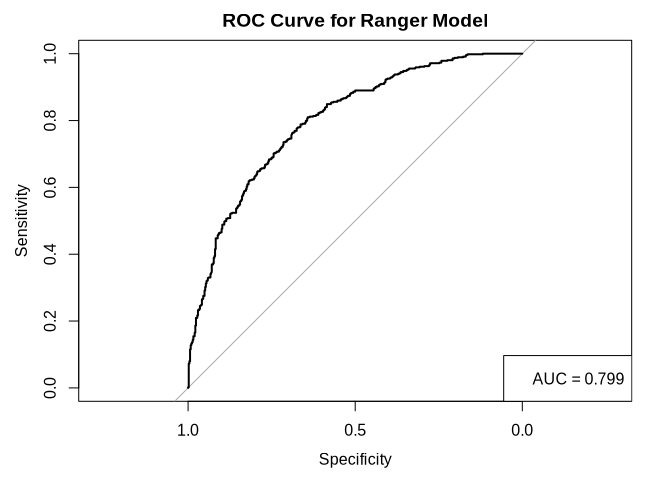
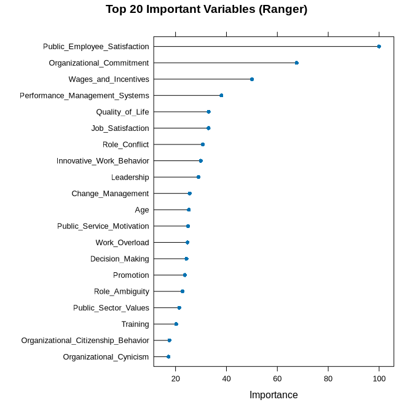
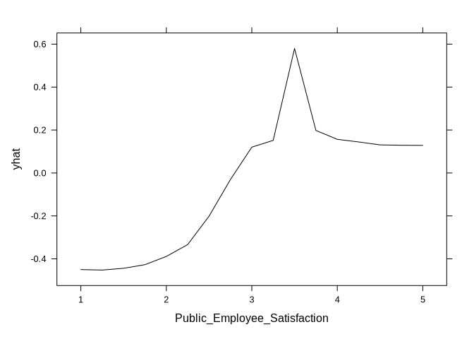

- 모형 비교에서 성능이 좋았던 랜덤 포레스트(`ranger`)를 격자 탐색으로
  튜닝

- 변수 중요도와 부분의존도(PDP)로 해석

- 필요한 파일: `data_cleaned.csv` (`01_logistic_regression.Rmd`가 만든
  파일)

## 1. 준비

``` r
library(caret)       # 학습과 교차검증
```

``` r
library(ranger)      # 빠른 랜덤 포레스트
library(pROC)        # ROC, AUC
```

``` r
library(pdp)         # 부분의존도
```

``` r
library(doParallel)  # 병렬 처리

options(scipen = 999)
registerDoParallel(detectCores())
```

## 2. 자료 준비

``` r
data <- read.csv("data_cleaned.csv")
data$Turnover_Intention <- factor(data$Turnover_Intention, levels = c(0, 1), labels = c("No", "Yes"))
table(data$Turnover_Intention)
```

    ## 
    ##   No  Yes 
    ## 2035 2253

``` r
set.seed(1)
train_idx  <- createDataPartition(data$Turnover_Intention, p = 0.75, list = FALSE)
train_data <- data[train_idx, ]
test_data  <- data[-train_idx, ]

# 예측변수(x)와 결과변수(y) 분리: 결과변수 열은 이름으로 제외 (x에 섞이지 않도록)
x_train <- train_data[, setdiff(names(train_data), "Turnover_Intention")]
y_train <- train_data$Turnover_Intention
x_test  <- test_data[, setdiff(names(test_data), "Turnover_Intention")]
y_test  <- test_data$Turnover_Intention

table(y_train)
```

    ## y_train
    ##   No  Yes 
    ## 1527 1690

``` r
table(y_test)
```

    ## y_test
    ##  No Yes 
    ## 508 563

## 3. 모형 학습

### 3.1. 교차검증과 탐색 격자

``` r
my_control <- trainControl(
  method = "repeatedcv", number = 10, repeats = 5,  # 10겹 교차검증 5회 반복
  classProbs = TRUE, summaryFunction = twoClassSummary,
  savePredictions = "all", allowParallel = TRUE
)

ranger_grid <- expand.grid(
  mtry          = seq(2, floor(sqrt(ncol(x_train))), by = 2),  # 분기마다 고려할 변수 수
  splitrule     = c("gini", "extratrees"),                     # 분할 규칙
  min.node.size = c(3, 5, 10)                                  # 잎 노드의 최소 사례 수
)
nrow(ranger_grid)  # 탐색할 조합 수
```

    ## [1] 18

### 3.2. 학습

``` r
set.seed(1)
ranger_fit <- train(
  x = x_train, y = y_train,
  method     = "ranger",
  trControl  = my_control,
  tuneGrid   = ranger_grid,
  preProcess = c("center", "scale"),
  metric     = "ROC",
  importance = "impurity",  # 불순도 감소량 기준 변수 중요도
  respect.unordered.factors = TRUE
)
ranger_fit
```

    ## Random Forest 
    ## 
    ## 3217 samples
    ##   55 predictor
    ##    2 classes: 'No', 'Yes' 
    ## 
    ## Pre-processing: centered (55), scaled (55) 
    ## Resampling: Cross-Validated (10 fold, repeated 5 times) 
    ## Summary of sample sizes: 2896, 2895, 2895, 2895, 2895, 2896, ... 
    ## Resampling results across tuning parameters:
    ## 
    ##   mtry  splitrule   min.node.size  ROC        Sens       Spec     
    ##   2     gini         3             0.8207094  0.6839216  0.7823669
    ##   2     gini         5             0.8213048  0.6814388  0.7884024
    ##   2     gini        10             0.8209911  0.6798736  0.7871006
    ##   2     extratrees   3             0.8141349  0.7028999  0.7533728
    ##   2     extratrees   5             0.8141109  0.6959778  0.7558580
    ##   2     extratrees  10             0.8131505  0.6887590  0.7629586
    ##   4     gini         3             0.8260439  0.6889078  0.7871006
    ##   4     gini         5             0.8254636  0.6873332  0.7859172
    ##   4     gini        10             0.8260175  0.6834082  0.7939645
    ##   4     extratrees   3             0.8205057  0.6987281  0.7692308
    ##   4     extratrees   5             0.8205835  0.6971517  0.7721893
    ##   4     extratrees  10             0.8191773  0.6888966  0.7757396
    ##   6     gini         3             0.8277298  0.6902133  0.7907692
    ##   6     gini         5             0.8280973  0.6898340  0.7911243
    ##   6     gini        10             0.8272057  0.6879868  0.7928994
    ##   6     extratrees   3             0.8232530  0.7001591  0.7751479
    ##   6     extratrees   5             0.8237033  0.6975344  0.7772781
    ##   6     extratrees  10             0.8233752  0.6913760  0.7803550
    ## 
    ## ROC was used to select the optimal model using the largest value.
    ## The final values used for the model were mtry = 6, splitrule = gini
    ##  and min.node.size = 5.

## 4. 평가 자료 성능

- ROC 곡선에서 Youden 지수가 최대인 분류점으로 이직의도 분류

``` r
ranger_prob <- predict(ranger_fit, newdata = x_test, type = "prob")

roc_obj <- roc(y_test, ranger_prob$Yes)
```

    ## Setting levels: control = No, case = Yes

    ## Setting direction: controls < cases

``` r
best <- coords(roc_obj, "best")
best
```

<div class="kable-table">

| threshold | specificity | sensitivity |
|----------:|------------:|------------:|
| 0.4875167 |   0.6633858 |   0.7886323 |

</div>

``` r
threshold <- best$threshold

ranger_class <- factor(ifelse(ranger_prob$Yes > threshold, "Yes", "No"), levels = c("No", "Yes"))
cm <- confusionMatrix(ranger_class, y_test, positive = "Yes")
cm
```

    ## Confusion Matrix and Statistics
    ## 
    ##           Reference
    ## Prediction  No Yes
    ##        No  337 119
    ##        Yes 171 444
    ##                                                
    ##                Accuracy : 0.7292               
    ##                  95% CI : (0.7015, 0.7556)     
    ##     No Information Rate : 0.5257               
    ##     P-Value [Acc > NIR] : < 0.00000000000000022
    ##                                                
    ##                   Kappa : 0.4543               
    ##                                                
    ##  Mcnemar's Test P-Value : 0.002746             
    ##                                                
    ##             Sensitivity : 0.7886               
    ##             Specificity : 0.6634               
    ##          Pos Pred Value : 0.7220               
    ##          Neg Pred Value : 0.7390               
    ##              Prevalence : 0.5257               
    ##          Detection Rate : 0.4146               
    ##    Detection Prevalence : 0.5742               
    ##       Balanced Accuracy : 0.7260               
    ##                                                
    ##        'Positive' Class : Yes                  

``` r
TP <- cm$table[2, 2]; TN <- cm$table[1, 1]; FP <- cm$table[2, 1]; FN <- cm$table[1, 2]
data.frame(
  Metric = c("Accuracy", "Sensitivity", "Specificity", "FPR", "FNR"),
  Value  = c((TP + TN) / sum(cm$table), TP / (TP + FN), TN / (TN + FP),
             FP / (TN + FP), FN / (TP + FN))
)
```

<div class="kable-table">

| Metric      |     Value |
|:------------|----------:|
| Accuracy    | 0.7292250 |
| Sensitivity | 0.7886323 |
| Specificity | 0.6633858 |
| FPR         | 0.3366142 |
| FNR         | 0.2113677 |

</div>

``` r
auc_value <- auc(roc_obj)
auc_value
```

    ## Area under the curve: 0.7994

``` r
plot(roc_obj, main = "ROC Curve for Ranger Model")
legend("bottomright", paste("AUC =", round(auc_value, 3)))
```

<!-- -->

## 5. 해석

### 5.1. 변수 중요도

``` r
ranger_importance <- varImp(ranger_fit)
plot(ranger_importance, top = 20, main = "Top 20 Important Variables (Ranger)")
```

<!-- -->

``` r
# 중요도 순으로 정렬한 상위 20개 변수
imp <- ranger_importance$importance
top_20_vars <- rownames(imp)[order(-imp$Overall)][1:20]
top_20_vars
```

    ##  [1] "Public_Employee_Satisfaction"        "Organizational_Commitment"          
    ##  [3] "Wages_and_Incentives"                "Performance_Management_Systems"     
    ##  [5] "Quality_of_Life"                     "Job_Satisfaction"                   
    ##  [7] "Role_Conflict"                       "Innovative_Work_Behavior"           
    ##  [9] "Leadership"                          "Change_Management"                  
    ## [11] "Age"                                 "Public_Service_Motivation"          
    ## [13] "Work_Overload"                       "Decision_Making"                    
    ## [15] "Promotion"                           "Role_Ambiguity"                     
    ## [17] "Public_Sector_Values"                "Training"                           
    ## [19] "Organizational_Citizenship_Behavior" "Organizational_Cynicism"

### 5.2. 부분의존도

- 가장 중요한 변수의 값에 따른 이직의도 예측의 평균적 변화

``` r
most_important_var <- top_20_vars[1]
pd <- partial(ranger_fit, pred.var = most_important_var, train = x_train)
plotPartial(pd)
```

    ## Warning in plotPartial(pd): pdp::plotPartial() is deprecated and will be
    ## removed in a future release. Please use plot(..., lattice = TRUE) instead; see
    ## ?pdp::plot.partial for details.

<!-- -->
